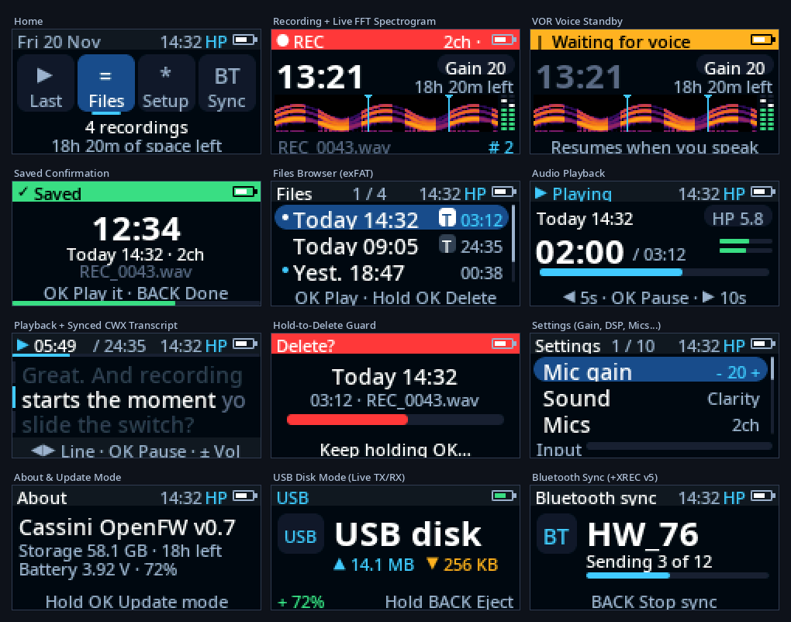
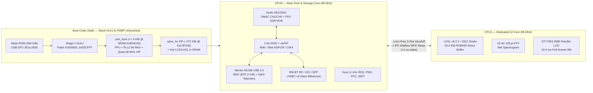

# Open-Source Firmware for the SL6801 Voice Recorder (`open_fw`)

**Standalone, bare-metal open-source firmware** and companion host tools for an inexpensive clip-on USB-C & Bluetooth voice recorder based on the **Smartlink SL6801** dual-core Cortex-M4F SoC (`HW_76` / `HW-A1`, [example AliExpress listing](https://de.aliexpress.com/item/1005013194457743.html)).

> **Project Scope:** This firmware is **not** intended as a generic MP3 player replacement. Its goal is to turn affordable off-the-shelf hardware into a **reliable, dedicated companion voice recorder** — instant one-switch capture, clean readable UI, rock-solid USB-C & Bluetooth syncing, and zero proprietary blobs.

Out of the box, the hardware packs dual differential microphones, 64 GB of storage, a `0.96"` color TFT display, a physical record slide switch, headphone jack, built-in speaker, USB-C, and Classic Bluetooth. Unfortunately, its factory firmware is closed-source, hard to read, crashes in a 15-second USB disconnect loop on Linux, and locks Bluetooth to phone-call audio only.

**`open_fw`** replaces the factory firmware cleanly from scratch in C99 + **LVGL v9.2.2**.

---

## Project Status

The core recorder firmware is **working and verified on physical `HW_76` silicon**. The remaining major milestone is completing **Bluetooth connectivity**.

| Subsystem | Status | Notes |
| :--- | :---: | :--- |
| **Dual-Mic Audio Recording & DSP** | Working | Instant `PB6` slide-switch capture to exFAT WAV, `AMIC1 + AMIC2` stereo/mono, clean-room `Voice Clarity` / `ASR Raw` / `Bypass` DSP, optional VOR (200 ms pre-roll + 500 ms hangover), live 128-pt FFT Mel spectrogram + markers |
| **Audio Playback & Transcripts** | Working | On-device WAV (PCM & IMA-ADPCM) playback with 32-step log-dB volume, automatic speaker (`PB30` PA) / 3.5 mm headphone (`PB11`) switching, audible pitch-preserving `2×–5×` hold-scrubbing, and synced `.cwx` word-level captions |
| **Dual-Core LVGL v9.2.2 UI** | Working | Dedicated **CPU1 (96 MHz)** UI worker with IPC Mailbox `WFE` sleep, 4-bit anti-aliased Noto Sans fonts, EEZ Studio screens, smooth strip reveals, and `289 ms` cold boot |
| **Crash-Safe exFAT Storage** | Working | 1-bit SDIO (`CMD18`/`CMD25` bursts + fallback), periodic WAV checkpointing, atomic staged file replace, `fsck.exfat`-clean |
| **USB-C Drive Mode & Telemetry** | Working | Clean-room Mentor MUSB USB Mass Storage (`1209:0001`, `~810 KB/s` via EP2 `2 KiB` FIFO, no Linux disconnect loop) + vendor SCSI `0xE0` live log, RTC sync & SRAM experiment runner |
| **Bluetooth Connectivity (`+XREC v5`)** | **Next Milestone** | Clean-room RF/VCO/BPF calibration, `RW-BT` HCI controller glue, SPP framing, and `+XREC v5` protocol are written and unit-tested; end-to-end on-device BT pairing & sync soak is the next active work item |

---

## The Hardware & UI

| The Device (`HW_76` / `HW-A1`) | Original Factory Software (QEMU) | `open_fw` Home Screen (QEMU) |
| :---: | :---: | :---: |
| <br/>*Front & side hardware profile* | <br/>*Stock `pen133_2.0.65` UI (captured in QEMU)* | <br/>*`open_fw` LVGL v9.2.2 landscape UI (captured in QEMU)* |

### Full `open_fw` UI Showcase

Every screen below is rendered directly by the real compiled `open_fw` C firmware (LVGL v9.2.2 + EEZ Studio + ST7735S LCDC driver, captured via `make -C open_fw test-host`):

<p align="center">
  
</p>

### Physical Controls & Hardware Layout

<p align="center">
  
</p>

| Control | Input | Behavior in `open_fw` |
| :--- | :--- | :--- |
| **Record Slide Switch** | `PB6` (active-low) | **Slide UP:** instant stereo/mono WAV recording from any screen. **Slide DOWN:** stop, finalize WAV, and show Saved screen. |
| **OK / Play** | `PD0` KADC ladder | Open/confirm, play/pause, drop a cyan spectrogram marker while recording, or hold in Files to delete. |
| **Back** | `PD0` KADC ladder | Navigate back, exit sync, or hold in USB mode to safely eject. |
| **Prev / Next** | `PD0` KADC ladder | Navigate tiles/lists; during playback: tap to skip (`5/10s`, `10/30s`, or track), double-tap for prev/next file, hold for audible `2×–5×` scrub. |
| **VOL+ / VOL−** | `PD0` KADC ladder | Adjust speaker/headphone volume (`32`-step log dB) or Settings values. |
| **Power (ON/OFF)** | `PMU reg 0x31` | Short press: wake/blank display; hold `2 s`: clean power-off (or charging standby on USB). Hold `8 s`: hardware PMU rescue reset. |

For the complete transcribed factory manual and hardware variants, see **[docs/DEVICE_MANUAL.md](docs/DEVICE_MANUAL.md)**.

---

## How It Works

### Architecture Overview



### Key Design Highlights

1. **Non-Destructive Boot & Flash Safety:**
   - The chip's Stage-1 `HLKJ` bootloader (`0x000000..0x00CFFF`) and factory `PSMP` NVRAM (`0x1FC000..0x1FFFFF`, holding RF calibration trims & Bluetooth MAC) are **never overwritten**.
   - `open_fw` lives strictly inside the `FIRM` partition (`0x00E000+`). A tiny `<= 4 KiB` `.ram_boot` trampoline enables the Cortex-M4F FPU (`fpv4-sp-d16`), boosts PLL0 to `96 MHz`, and switches SPI NOR to **Quad I/O `0xEB` @ 48 MHz** XIP.
   - Hardware watchdog (`WDT` → PMU cold reset) + 3-strike boot-loop protection in `AON_BACKUP` + `8 s` PMU power-button rescue prevent soft-bricks.
2. **True Dual-Core Split (`CPU0` + `CPU1`):**
   - **CPU0** handles real-time audio DMA, clean-room DSP, exFAT I/O, USB MSC, input debouncing, and Bluetooth so audio recording never drops a frame.
   - **CPU1** renders **LVGL v9.2.2**, 20 Hz Mel spectrogram FFTs, and `10.4 ms` ST7735S LCD blits asynchronously, then halts in zero-power hardware **`WFE` sleep** woken in `< 1 µs` via the SL6801 IPC Mailbox (`0x40070000`, IRQ `55`). On single-core QEMU or host tests, it falls back seamlessly to CPU0.
3. **Clean-Room Audio & ASR Pipeline:**
   - Dual analog mics (`AMIC1 + AMIC2`) stream through DMAC CH1 into a 4-slot ring buffer, processed in hardware floating-point (`audio_dsp.c`) with three selectable profiles: **`Voice Clarity`** (350 Hz HPF + 2.2 kHz `+9 dB` shelf + 2:1 compressor + limiter), **`ASR Raw`** (75 Hz HPF + transparent peak limiter for Parakeet/Whistle), and **`Bypass`**.
   - Playback (`player.c` + `audio_dac.c`) decodes PCM and IMA-ADPCM WAV files, supports synchronized `.cwx` word-level transcripts (`cwx.c`), and routes audio automatically between the 3.5 mm headphone jack (`PB11`) and the built-in speaker (`PB30` PA).
4. **Host-First Testing & Zero-Wire Debugging:**
   - Every hardware driver uses a compile-time MMIO abstraction (`OPENFW_HOST_MMIO`) so **6 native host test suites** run in seconds on Linux under **ASan + UBSan** and validate exFAT images with real `fsck.exfat -n`.
   - On physical hardware, `open_fw` exposes a **vendor SCSI `0xE0`** command channel alongside normal USB Mass Storage (`1209:0001`), letting [`tools/dev_cycle.py`](tools/dev_cycle.py) read the 4 KiB SRAM ring log, sync the RTC, reboot into BootROM DFU, or upload/execute 2-second C hardware probes in SRAM (`0x00850000`) with zero UART wiring.

---

## Quick Start

### 1. Build & Run the Automated Test Suite (No Hardware Needed)

Requires `clang`, `lld`, `llvm` (`llvm-objcopy`), `cc`, `exfatprogs`, `python3`, and `python3-pil`. LVGL v9.2.2 is fetched automatically into `open_fw/third_party/lvgl/` on the first build:

```bash
# Build the ARM Cortex-M4F firmware and run all 6 host unit/MMIO/UI test suites
make -C open_fw all test-host

# Run with AddressSanitizer + UndefinedBehaviorSanitizer
make -C open_fw test-host-san

# Run the Python host tool self-tests
python3 tools/test_tools.py
```

### 2. Try `open_fw` Live in Your Browser (WebAssembly Emulator)

No hardware, Boot ROM dump, or QEMU install required — the real C firmware + LVGL v9.2.2 + exFAT + Audio DSP/Player compiles directly to WebAssembly (`web_emu/openfw.wasm`) with live Web Audio playback and microphone recording:

```bash
# Optional: rebuild web_emu/openfw.wasm from C source (requires clang + wasm-ld)
make -C open_fw wasm

# Launch local server (sets COOP/COEP headers) and open http://127.0.0.1:8080/
python3 web_emu/serve.py --open
```

For the native host UI renderer and full ARM QEMU emulator, see **[docs/EMULATOR_GUIDE.md](docs/EMULATOR_GUIDE.md)**.

### 3. Flash `open_fw` to Your SL6801 Device

> [!CAUTION]
> Always **dump and back up your stock 2 MiB SPI NOR flash** (`dumps/firmware_2M.bin`) before flashing for the first time! You can enter BootROM USB DFU (`301a:2800`) at any time by holding **Prev** (or **Next** on some revisions) while plugging in USB.

```bash
# Install udev rules for non-root USB access (DFU 301a:2800 + OpenFW 1209:0001)
sudo cp 50-smartlink-sl6801.rules /etc/udev/rules.d/
sudo udevadm control --reload-rules

# Build open_fw and pack the 2 MiB flash image (requires your local dumps/firmware_2M.bin)
make -C open_fw all update-up

# Safely flash ONLY the partition table + FIRM region (never touches HLKJ or PSMP NVRAM)
sudo python3 tools/dev_cycle.py flash

# Pull live boot/runtime telemetry over USB (no UART wires needed)
python3 tools/dev_cycle.py log
```

### 4. Sync Recordings Over USB

```bash
python3 tools/usb_sync.py --dest ~/Recordings/HW_76
```

---

## Repository Map & Documentation

| Path | Description |
| :--- | :--- |
| **[`open_fw/`](open_fw/)** | Standalone open-source firmware in C99 + LVGL v9.2.2 (drivers, dual-core UI, exFAT, audio DSP/recorder/player, USB MSC, BT stack, host tests, SRAM probes, WASM SoC, QEMU scripts). See **[open_fw/README.md](open_fw/README.md)**. |
| **[`web_emu/`](web_emu/)** | Interactive browser emulator running the real compiled `open_fw` firmware in WebAssembly (`openfw.wasm`) with live Web Audio playback, mic recording, and virtual exFAT microSD. |
| **[`tools/`](tools/)** | Python host tools: flashing & dev cycle (`dev_cycle.py`, `flash_ranges.py`), USB telemetry & sync (`openfw_usb.py`, `usb_sync.py`), ASR prep (`asr_prep.py`), Cassini meeting converter (`cassini_to_device.py`), and legacy stock-FW helpers. See **[tools/README.md](tools/README.md)**. |
| **[`docs/`](docs/)** | Complete technical documentation (indexed below). |
| **[`fw_mod/`](fw_mod/)** | Optional / legacy XIP binary patches for the original stock `pen133_2.0.65` firmware. See **[fw_mod/README.md](fw_mod/README.md)**. |
| **[`assets/`](assets/)** | Boot splash artwork (`cassini_welcome_80x40.png`). |
| **[`50-smartlink-sl6801.rules`](50-smartlink-sl6801.rules)** | Linux udev rules for non-root USB access and stock-firmware disconnect workaround. |

### Documentation Index

- **[docs/SL6801_HW76_HARDWARE.md](docs/SL6801_HW76_HARDWARE.md)** — Verified SL6801 register map, pinout, audio codec, PMU/reset domains, MUSB FIFO quirks, and dual-core silicon findings.
- **[docs/LVGL_ARCHITECTURE.md](docs/LVGL_ARCHITECTURE.md)** — Layered LVGL v9.2.2 + EEZ Studio UI architecture, CPU1 worker + IPC `WFE` sleep, memory budget, and multi-device porting.
- **[docs/DEVELOPMENT_WORKFLOW.md](docs/DEVELOPMENT_WORKFLOW.md)** — Host-first ASan/UBSan verification gate, zero-wire on-silicon profiling, and 2-second SRAM hardware probing (`DEV_EXP=1`).
- **[docs/EMULATOR_GUIDE.md](docs/EMULATOR_GUIDE.md)** — Host visual UI renderer, headless ARM QEMU harness, and interactive browser emulator.
- **[docs/CLEAN_ROOM_AUDIO_PLAN.md](docs/CLEAN_ROOM_AUDIO_PLAN.md)** — Clean-room audio DSP (`ASR Raw`, `Voice Clarity`, `Bypass`), VOR, speaker PA / log-dB volume, and Parakeet/Whistle ASR prep.
- **[docs/UI_UX_DISPLAY_KIT.md](docs/UI_UX_DISPLAY_KIT.md)** — `160×80` display specs, 4-bit AA Noto Sans fonts, 14-color dark-mode palette, and physical button UX guide.
- **[docs/XREC_PROTOCOL.md](docs/XREC_PROTOCOL.md)** — Classic Bluetooth BR/EDR SPP + `+XREC v5` pairing, authentication, and binary burst sync protocol.
- **[docs/DEVICE_MANUAL.md](docs/DEVICE_MANUAL.md)** — Clean English transcription of the factory HW-A1 / HW-XX user manual and enclosure button variants.
- **[docs/FIRMWARE_ANALYSIS.md](docs/FIRMWARE_ANALYSIS.md)** — Deep reverse-engineering & Thumb-2 disassembly notes on the stock `pen133_2.0.65` firmware and Mask BootROM.

---

## Optional: Keeping the Stock Firmware? (Linux USB Bug Fix)

If you want to keep the original factory software and only fix its 15-second Linux USB disconnect loop (caused by Linux probing the final 4 KiB sectors of the 64 GB partition), install the udev rule and shrink the exFAT partition boundary by 1 cluster (`128 KiB`). Always run `--dry-run` first and back up important recordings:

```bash
sudo cp 50-smartlink-sl6801.rules /etc/udev/rules.d/
sudo udevadm control --reload-rules

sudo python3 tools/fix_exfat_boundary.py --dry-run /dev/sdX
sudo python3 tools/fix_exfat_boundary.py /dev/sdX
```

For optional XIP patches to the stock firmware (encrypted BT file sync, WAV `blockAlign` fix, Linux USB patch), see **[fw_mod/README.md](fw_mod/README.md)**.

---

## Porting to Other SL6801 Devices & Community Projects

Feel free to use or adapt any of this code and documentation for your own projects (MIT licensed). We are not looking for general feature or UI PRs, **with one exception**: if you own a different SL6801-based voice recorder and want to figure out how to flash or port `open_fw` to your hardware, hardware notes and porting PRs are very welcome!

- **Board Profile:** [`open_fw/include/board_config.h`](open_fw/include/board_config.h) & **[docs/LVGL_ARCHITECTURE.md](docs/LVGL_ARCHITECTURE.md#2-adapting-to-another-voice-recorder)**.
- **Related Community Projects:** Builds on [`ilyakurdyukov/smartlink_flash`](https://github.com/ilyakurdyukov/smartlink_flash), [`anton-veretenenko/smartlink-sl6801-emulator`](https://github.com/anton-veretenenko/smartlink-sl6801-emulator), and [`dbrant/SL6801_player`](https://github.com/dbrant/SL6801_player) (see [docs/SL6801_HW76_HARDWARE.md](docs/SL6801_HW76_HARDWARE.md#8-related-open-source-projects--online-documentation) for the full list).

---

## License

All code and documentation in this repository are released under the **[MIT License](LICENSE)**. No proprietary factory firmware or Boot ROM binaries are included — if you want to back up or patch the original software, dump it from your own device.
