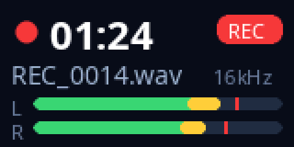

# Open-Source Alternative Firmware for the SL6801 Voice Recorder

This repository is an effort to provide **clean, open-source alternative software** (standalone firmware + computer tools) for an inexpensive clip-on USB-C & Bluetooth voice recorder sold online ([example product listing on AliExpress](https://de.aliexpress.com/item/1005013194457743.html)).

Out of the box, the recorder has surprisingly capable hardware — 64 GB of storage, dual microphones, a color screen, a physical record switch, headphone jack, speaker, USB-C, and Bluetooth — but its factory software is closed-source, hard to read, crashes in a 15-second disconnect loop when plugged into Linux, and locks Bluetooth to phone-call audio only.

Our goal is to replace that factory software with a **fast, reliable, easy-to-read open-source firmware (`open_fw`)** that you fully control.

---

## The Device vs. Our Alternative Software

| The Device (Product Photo) | Our Alternative Open-Source UI (`open_fw`) |
| :---: | :---: |
| <br/>*Hardware front & side profile (marketing render shown on screen)* | <br/>*4-bit anti-aliased recording UI (3× zoom) — [see all 5 UI screens](docs/assets/ux_showcase_sheet.png)* |

---

## Hardware & Buttons (From the Manual)

The device is a pocket clip-on voice recorder with a **0.96" color screen (`160×80` pixels)**, a dedicated physical **Record Slide Switch**, **6 buttons**, a **3.5 mm headphone jack**, **dual microphones**, a **built-in speaker**, **64 GB storage**, and **USB-C**:

<p align="center">
  
</p>

Under the hood, it runs on a **Smartlink SL6801** chip (ARM Cortex-M4F processor with 2 MB of built-in flash memory and 512 KB of RAM).

---

## Current Progress (`open_fw`)

The standalone open-source firmware already boots and runs natively on the real hardware:

- **Audio Recording:** Stereo WAV recording from the built-in dual microphones straight to the 64 GB exFAT storage.
- **Audio Playback:** Headphone playback directly from saved recordings via the on-chip DAC.
- **Crisp Anti-Aliased Display:** Custom 4-bit (16-level) anti-aliased fonts and rounded UI primitives that render in under 4 ms on the `0.96"` screen, plus a 2-second boot animation.
- **Reliable USB-C Drive Mode:** Plug it into Linux, macOS, or Windows and copy recordings without the factory firmware's 15-second disconnect bug.
- **Desktop Emulator & Safe Testing:** Prototype UI changes in a desktop QEMU emulator or test code directly in device RAM without wearing out flash memory.
- **Stock Firmware Tools (Optional):** If you prefer to keep the factory software, this repo also includes a safe, zero-data-loss Linux USB fix and a custom Bluetooth file-transfer patch (`fw_mod/`).

---

## What's in This Repository

| Folder / File | What It Does |
| :--- | :--- |
| **[`open_fw/`](open_fw/)** | Standalone open-source firmware written from scratch in C (drivers, exFAT filesystem, audio recording/playback, anti-aliased UI, USB drive mode, and tests). |
| **[`tools/`](tools/)** | Python utilities for syncing recordings over USB or Bluetooth, fixing the factory Linux USB bug, inspecting firmware images, and running live RAM experiments. |
| **[`docs/`](docs/)** | Human-readable guides: **[UI/UX Display Kit](docs/UI_UX_DISPLAY_KIT.md)**, **[Hardware Reference](docs/SL6801_HW76_HARDWARE.md)**, and **[Bluetooth Sync Protocol](docs/XREC_PROTOCOL.md)**. |
| **[`fw_mod/`](fw_mod/)** | Optional add-on patches for the original factory firmware (adds encrypted Bluetooth file transfer and fixes the Linux USB bug). |
| **[`firmware_analysis.md`](firmware_analysis.md)** | Deep technical reverse-engineering notes on the original factory firmware and chip internals. |

---

## Quick Start

### 1. Just want to fix the Linux USB disconnect bug on the original firmware?
The factory software freezes every 15 seconds on Linux because Linux checks the very last sectors of the 64 GB drive, triggering a bug in the recorder. You can fix it permanently with zero data loss:

```bash
# Install the udev rule
sudo cp 50-smartlink-sl6801.rules /etc/udev/rules.d/
sudo udevadm control --reload-rules

# Shrink the partition metadata by 128 KB so Linux stays clear of the buggy end-of-disk sectors
sudo python3 tools/fix_exfat_boundary.py /dev/sdX
```

### 2. Build & test the alternative firmware (`open_fw`) on your PC
You don't even need the hardware to build and run the automated test suite:

```bash
make -C open_fw all test-host
```

### 3. Sync recordings automatically over USB
```bash
python3 tools/usb_sync.py --dest ~/Recordings/HW_76
```

---

## Want to Help Design the UI or Contribute?

- **UI / UX Designers:** Check out **[docs/UI_UX_DISPLAY_KIT.md](docs/UI_UX_DISPLAY_KIT.md)** and **[docs/assets/ux_showcase_sheet.png](docs/assets/ux_showcase_sheet.png)** — it shows the exact pixel resolution, built-in anti-aliased fonts, button layout, and visual examples of what the screen can do.
- **Firmware & Hardware Hackers:** See **[docs/SL6801_HW76_HARDWARE.md](docs/SL6801_HW76_HARDWARE.md)** for the verified register map, audio/LCD/PMU bring-up notes, and safe flashing workflow.
- **Related Community Projects:** This work builds on discoveries from [`ilyakurdyukov/smartlink_flash`](https://github.com/ilyakurdyukov/smartlink_flash) (USB flashing tool) and [`dbrant/SL6801_player`](https://github.com/dbrant/SL6801_player) (SL6801 reverse-engineering & SDK).

---

## License

All code and documentation in this repository are released under the [MIT License](LICENSE). No proprietary factory firmware or Boot ROM binaries are included — if you want to back up or patch the original software, you must dump it from your own device.
