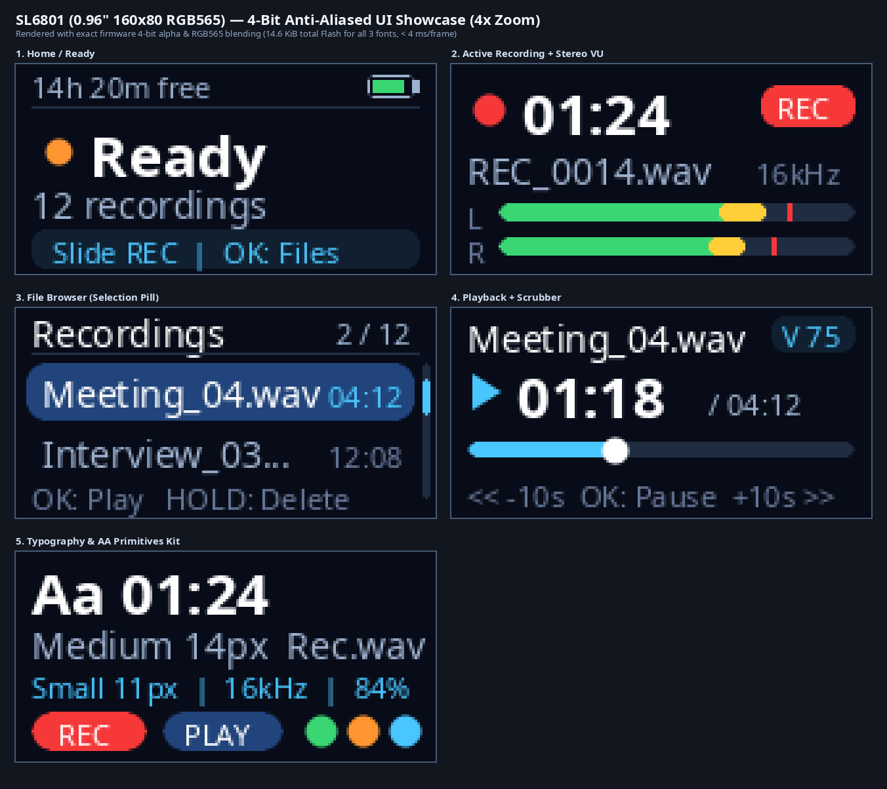

# Cassini OpenFW — UI/UX Display Capability Kit (`160×80` Anti-Aliased)

This document gives the UI/UX design team an accurate reference of what is visually and technically possible on the voice recorder's `0.96"` TFT display, along with hardware-faithful anti-aliased mockups.

---

## 1. Display Hardware & Rendering Capabilities

| Property | Specification |
| --- | --- |
| **Panel** | `0.96"` IPS/TFT (`ST7735S`), **160 × 80 px** (landscape) or **80 × 160 px** (portrait) |
| **Color depth** | **16-bit RGB565** (`65,536` colors) |
| **Interface & speed** | 8-bit 8080 parallel bus — full-screen text + UI updates render in **< 4 ms** (`> 60 fps` capable) |
| **Text rendering** | **4-bit (16-level) grayscale anti-aliased proportional fonts** blended in RGB565 |
| **Shape primitives** | Anti-aliased circles (`lcd_fill_circle_aa`), rounded pills/cards/bars (`lcd_fill_rrect_aa`), triangles/icons, alpha-blended RGB565 sprites (`lcd_blit_rgb565_alpha`), and 60 fps animations |
| **Backlight** | PWM dimmed `0–100%` (can dim smoothly before screen sleep) |
| **Flash budget** | ~**1.8 MiB free** in 2 MiB NOR Flash — plenty of room for custom fonts, crisp icons, and animations |

> **Why 4-bit grayscale AA (not ClearType subpixel AA)?**
> In landscape (`160×80`), the panel's R/G/B subpixel stripes are stacked vertically rather than horizontally, so horizontal RGB subpixel AA causes color fringing. 4-bit (16-level) grayscale AA gives crisp, fringe-free edges in both orientations.

---

## 2. Built-in Typography System (`open_fw/src/aa_fonts.c`)

Three full-ASCII (`32..126`) Noto Sans anti-aliased fonts are already built into firmware (**14.6 KiB total Flash** — custom TTF fonts can be swapped in at build time via `open_fw/tools/gen_aa_fonts.py`):

| Token | Font & Size | Line Height | Approx. Chars / `160 px` | Best Used For | Flash Size |
| --- | --- | --- | --- | --- | --- |
| `g_font_ui_lg` | Noto Sans Bold **22 px** | ~28 px | ~10–12 chars | Hero timers (`01:24`), primary state (`Ready`, `REC`) | 8.1 KiB |
| `g_font_ui_md` | Noto Sans Regular **14 px** | ~19 px | ~18–21 chars | Filenames (`Meeting_04.wav`), list items, menu options | 3.8 KiB |
| `g_font_ui_sm` | Noto Sans Regular **11 px** | ~15 px | ~24–28 chars | Metadata (`16kHz`, `14h 20m free`), badges, button hints | 2.6 KiB |

- **Automatic ellipsis truncation:** `lcd_draw_str_aa_trunc()` measures proportional pixel widths and cleanly appends `...` so long filenames never collide with right-aligned durations or badges.
- **Right/center alignment:** `lcd_measure_str_aa()` returns exact pixel width for any string.

---

## 3. Physical Controls (No Touchscreen)

All interactions use physical buttons + 1 hardware slide switch:

| Control | Physical Location | Recommended UX Role |
| --- | --- | --- |
| **REC Slide Switch** | Side (2-position hardware latch) | **Slide UP = Instant Record** (even from idle/playback); **Slide DOWN = Save & Stop** |
| **OK / ENTER** | Front center | Confirm / Play / Pause / Open Files |
| **BACK** | Front | Go back one level / Exit menu (long-press reserved only for power-user actions) |
| **LEFT / RIGHT** | Front | Previous/Next file, or `-10s` / `+10s` seek during playback |
| **VOL+ / VOL-** | Side or front | Adjust headphone volume during playback; scroll list items up/down |
| **POWER (ON/OFF)** | Side | Short press: wake / sleep screen; 2 s hold (unplugged): clean power off |

---

## 4. Pixel-Accurate Anti-Aliased Examples

Every mockup below is rendered at exact **`160 × 80`** hardware resolution using the **exact 4-bit alpha & RGB565 blending math** used on the device (exported at 3× zoom for easy inspection):

| Screen | Preview | Key Techniques Shown |
| --- | --- | --- |
| **1. Home / Ready** | [ux_01_home.png](assets/ux_01_home.png) | Top status bar (free time + battery), `22 px` bold status, file count, rounded bottom hint pill |
| **2. Active Recording** | [ux_02_recording.png](assets/ux_02_recording.png) | AA red dot + `22 px` bold timer, `REC` pill badge, live stereo L/R rounded VU bars with red peak-hold markers |
| **3. File Browser** | [ux_03_files.png](assets/ux_03_files.png) | Full-width AA rounded selection pill, right-aligned durations, automatic `...` truncation, slim scrollbar |
| **4. Playback** | [ux_04_playback.png](assets/ux_04_playback.png) | AA play triangle icon, big elapsed timer + muted total duration, rounded progress bar with AA scrubber dot, volume pill |
| **5. Typography & Primitives** | [ux_05_typography_kit.png](assets/ux_05_typography_kit.png) | All 3 AA font sizes, rounded status pills, AA circles/dots |

---

## 5. Practical Design Guidelines for `0.96"` (`160×80`)

1. **Dark-mode first:** Deep dark backgrounds (`#0A0F1A` / `#000000`) with high-contrast bright text (`#FFFFFF`, `#9CB0CE`) maximize legibility on a tiny backlit TFT and hide bezel edges.
2. **2–3 elements per screen max:** Treat each screen like a smartwatch glance — one hero element (`22 px` timer or active row), one supporting line (`14 px`), and one subtle status/hint bar (`11 px`).
3. **Avoid `1 px` dim borders & dense tables:** Use filled rounded pills (`#162136` / `#20447A`) for hierarchy and focus states instead of thin wireframe boxes.
4. **Design directly on a `160 × 80` px canvas (1×) in Figma:** Use `11 px`, `14 px`, and `22 px` (or any custom TTF sizes you prefer) — we can test any new screen in our QEMU emulator (`make -C open_fw test-qemu`) or live on the hardware in seconds.
5. **Fast iteration loop:** Once designs are ready, we prototype them in the desktop emulator first (instant PNG screenshots) and live-preview directly in device SRAM with zero flashing.
