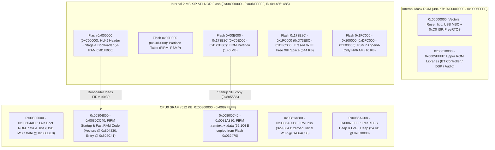

# Smartlink SL6801 (`HW_76` / `pen133_2.0.65`) — Firmware Disassembly & USB/Bluetooth Interaction Reference

This document synthesizes a clean-room binary and Thumb-2 disassembly analysis of the dumped flash image ([dumps/firmware_2M.bin](dumps/firmware_2M.bin)), internal mask ROM dump ([dumps/bootrom_64K.bin](dumps/bootrom_64K.bin)), and SD volume backup (`dumps/sdcard_backup/`), focused on **making sense of the firmware architecture** and **interacting with the device over USB and Bluetooth**.

> [!NOTE]
> Device-specific identifiers (the unit's Bluetooth MAC, factory serial string, and paired-device MAC addresses) are redacted in this public repository (`XX:XX:XX:XX:XX:xx`). Read the live values from your own dump's `PSMP` partition (see §2) or via `bluetoothctl`.

---

## 1. Dual-Core SoC, Boot ROM & Complete Memory Map

Disassembling the Boot ROM reset vector (`0x00000040` in [bootrom_64K.bin](dumps/bootrom_64K.bin)) and the `FIRM` startup code (`0x00804C40` / `0x0080555C` in [firmware_2M.bin](dumps/firmware_2M.bin)) reveals several previously undocumented architectural details of the **Smartlink SL6801**:

1. **Hardware Dual-Core Dispatch (`0x4000000C`):**
   * At reset (`0x00000068`), the Boot ROM reads `*(uint32_t *)0x4000000C` (`CPU_ID`):
     * **`CPU0` (`== 0`):** Application, FreeRTOS, LVGL UI, FatFs, USB, and Bluetooth Host (`spark_bt_*`) Cortex-M4F core. Initializes Boot ROM `.data` (`0x00800000..0x008006B4` from ROM `0x0005B800`) and zeroes Boot ROM `.bss` (`0x00800800..0x00804AB0`).
     * **`CPU1` (`!= 0`):** Bluetooth Baseband/Controller (`btc`) & DSP co-processor. Reads the entry pointer from mailbox `*(uint32_t *)0x30000600` (CPU1 SRAM `0x30000000`) and branches directly to it (`bx r0`).
2. **True Internal Mask ROM Size (`384 KB`, not `64 KB`):**
   * `FIRM` contains **273 distinct `BL`/`B.W` targets** into ROM (`< 0x00100000`), of which **148 lie above `0x00010000`** (clustering up to `0x0004C2CB` for exception vectors and **`0x0005B800`** for the Boot ROM `.data` load image).
   * [bootrom_64K.bin](dumps/bootrom_64K.bin) (`0x00000000..0x0000FFFF`) captures the reset startup, libc helpers (`rom_printf` `0x2B0`, `strlen` `0xAA2`, `strcmp` `0xAB2`, `memcpy` `0xB2A`, `memset` `0xBAA`, `memcmp` `0xC54`, `atoi` `0xD1E`), **the entire USB Device + USB Host Mass Storage stack (`0x4E00..0x8500`)**, and FreeRTOS kernel primitives (`SVC_Handler` `0xB4F4`, `SysTick_Handler` `0xB5A8`).

> [!TIP]
> You can dump the full **384 KB** mask ROM (`0x00000000..0x0005FFFF`) in normal Card Reader mode without opening the device:
> ```bash
> sudo /tmp/smartlink_flash/smtlink_dump --id 301a:2801 read_mem 0 384K dumps/bootrom_384K.bin
> ```

### Complete Runtime Address Map (`pen133_2.0.65`)



### Inside `FIRM` (`0x00E000..0x173E8C`)
| Flash Offset | Memory VMA | Size | Description |
| :--- | :--- | :--- | :--- |
| `0x00E000` | `0x00C0E000` | `0x000030` | `FIRM` header (`hdr=0x30`, BCD build timestamp `0x95904A60` / string `2509261408`, `load=0x804C00`, `entry=0x804C01`, `ram_size=0x1000`, `ram_crc=0x4724`) |
| `0x00E030` | `0x00804800` | `0x00AA5E` | Vector table, `Reset_Handler`, fast IRQ/RTOS/DMA routines |
| `0x018A8E` | *(reserved)* | `0x0209E2` | 133 KB zero-padded linker reservation (`FIRM+0x000030` to `FIRM+0x02B440` fixed `0x2B440` slot) |
| `0x039470` | `0x0080CC40` | `0x00D740` | **`.ramtext` + `.data` load image** (`VMA = flash_offset + 0x7D37D0`): holds SDIO (`HAL_sd_disk_read` at `0x8160C8`), USB MSC `ops` (`0x812A00..0x812E60`), LVGL fonts, and initialized globals |
| `0x048030` | `0x00C48030` | `0x07FD00` | XIP `.rodata`: debug format strings, 10-language UI string tables (`0x051000..0x055A3B`), LVGL images/icons (`0x09E000..0x0AA000`), GBK/Unicode tables |
| `0x0C8000` | `0x00CC8000` | `0x0ABE8C` | XIP `.text`: OAL/FreeRTOS wrappers, UI pages & presenters (`0xCE0000..0xD28000`), LVGL v8.3 (`0xD28000..0xD40000`), `PSMP` NVRAM (`0xD40480..0xD42000`), `/dev/*` drivers, FatFs exFAT (`0xD55000..`), and **`spark_bt_*` Bluetooth Host Stack (`0xD60000..0xD68000` + `0x0D6700..0x0DD400` logs)** |

---

## 2. `PSMP` NVRAM Format & Decoded Device Secrets (`0x1FC000`)

The 16 KB `PSMP` partition (`0x1FC000..0x200000`, 4 × 4 KB sectors) is a wear-leveled, append-only key-value store managed by `nv_get` (`0xD41E4C`), `nv_set` (`0xD41DDC`), and `nv_del` (`0xD41B16`).

### Record Binary Layout (`12 + key_len + val_len` bytes)
| Offset | Type | Field | Description |
| :--- | :--- | :--- | :--- |
| `+0x00` | `u16` | `magic` | Always `0xAA55` (`55 AA` on disk) |
| `+0x02` | `u8` | `status` | `0xFF` = **Active**, `0xFE` = **Obsolete** (cleared in-place on SPI NOR without sector erase when a new value is appended) |
| `+0x03` | `u32` | `crc32` | Raw IEEE 802.3 CRC-32 (`poly=0xEDB88320`, **`init=0x00000000`, `final_xor=0x00000000`**) computed over `key || val || header_12B` (with `header[2]=0xFF` and `header[3..6]=0xFFFFFFFF`) |
| `+0x07` | `u16` | `val_len` | Value byte length |
| `+0x09` | `u16` | `key_id` | Numeric key index (`1..15`) |
| `+0x0B` | `u8` | `key_len` | ASCII key name length (no NUL terminator) |
| `+0x0C` | `char[]` | `key` | Key string (`bt_addr`, `bt_name`, etc.) |
| `+0x0C+key_len` | `u8[]` | `val` | Raw value payload |

### Active Records in Your Dumped `firmware_2M.bin`
| ID | Key | Len | Value in Dump & Decoded Meaning |
| :--- | :--- | :--- | :--- |
| `1` | `bt_addr` | 6 | `xx xx xx xx xx 76` (little-endian) → Classic BT MAC **`XX:XX:XX:XX:XX:76`** |
| `2` | `device_id` | 64 | `'CBKJ01RECPENMP3-------T90081----------XXXXXXXXXX76064091--------'` (Factory serial/model string embedding MAC `XXXXXXXXXX76`) |
| `3` | `freq_drift` | 2 | `0x0049` (`73`) — RF crystal calibration trim |
| `4` | `profile` | 4 | `00 02 00 00` — System UI/backlight/power settings |
| `5` | `pass` | 4 | `00 00 63 63` — Power-on password disabled (`00 00`) |
| `6` | `record` | 28 | Voice recorder settings: bitrate mode `3`, segment **`120 min`**, scheduled start `08:30` / end `09:30`, VAD/monitor/denoise flags |
| `7` | `music` | 20 | Last played track (`#1`, pos `45s`, play mode `4`) |
| `8` | `audio_volume` | 16 | Four `u32` gains: speaker/headphone volume `10`, `100`, `90`, `90` |
| `9` | `voltage` | 4 | `0x0104` (`260`), `100%` battery state |
| `10` | `bt_name` | 64 | `'HW_76\0...'` — **Editable Bluetooth broadcast name** (initialized from `HW_` + `bt_addr[0]`) |
| `11` | `bt_info` | 1 | `0x00` = BT Off (`0x01` = **`music mode`** A2DP Source, `0x02` = **`phone mode`** HFP Hands-Free) |
| `12` | `btlinknum` | 4 | `2` paired Bluetooth devices stored |
| `13` | `btlinkinfo` | 192 | Two 96-byte pairing slots (`flags[4]`, `bd_addr_le[6]`, `key_type[2]=0x0004`, **`link_key[16]`**, `remote_name[64]`, `cod[4]=0x00240404`):<br>• Slot 0: `XX:XX:XX:XX:XX:5C` (`"SLANG-M5 Armored Cavalry"`)<br>• Slot 1: `XX:XX:XX:XX:XX:EB` (`"Jabra Hear Me Out"`) |
| `14` | `btrlk` | 6 | `xx xx xx xx xx eb` → Last-connected headphone MAC `XX:XX:XX:XX:XX:EB` |
| `15` | `language` | 2 | `0x0000` |

> [!NOTE]
> **Minor RIFF WAV Header Quirk in Recordings (`dumps/sdcard_backup/record/*.wav`):**
> The four `*-120min.wav` files in `0:\record` are uncompressed `PCM_S16LE` (`fmt=0x0001`), **2 channels, 16,000 Hz**, `byteRate = 64,000 B/s`, `bitsPerSample = 16`, but the firmware writes **`blockAlign = 2` instead of `4`** (`channels * bitsPerSample / 8`). Standard tools (`ffmpeg`, `aplay`, `sox`) play them fine, though strict RIFF validators may warn unless `blockAlign` at file offset `0x20` is patched to `0x0004`.

---

## 3. Interacting via USB (`301a:2801` & `301a:2800`)

### 3.1 USB Architecture & Plug-In Behavior
The device implements **only** USB 2.0 Full-Speed **Mass Storage Bulk-Only Transport (`bInterfaceClass = 0x08`, Bulk-Only `0x50`)** — there are no hidden composite HID, CDC-ACM serial, USB Audio, or MTP descriptors in either `BootROM` or `FIRM`.

When VBUS is detected during normal operation (`pstr_usb_option_process`):
* The screen prompts **`Charge & Transfer`** vs **`Charge & Play`**.
* Selecting **`Charge & Transfer`** closes Bluetooth (`USB reader, close bt`), disables local recording, calls `usbd_msc_cardreader_init` (`0xD3A580`), registers `FIRM`'s `ops` table (`0x812A00..0x812AD9`) into Boot ROM's USB MSC state via `usb_set_userfn` (`0x5914` -> `*(0x801068)`), and enumerates as **`301a:2801`** (`SMTLINK CARDREADER 1.00`).
* Selecting **Settings → Update Options → `PC Upgrade`** sets a PMU flag (`HAL_pmu_pc_update_flag_set`) and reboots into the Bootloader's USB update mode (**`301a:2800`**, no hardware boot-key press needed).

### 3.2 Exact Instruction-Level Root Cause of the 15s Linux Disconnect Loop
Disassembling `FIRM`'s SCSI CDB interceptor (`0x812AD8`) and SDIO reader (`HAL_sd_disk_read` at SRAM **`0x8160C8`**, flash `0x0428F8`) pinpoints the exact firmware bug described in [README.md](README.md):

1. `FIRM` intercepts SCSI `0x28` (`READ(10)`), `0x2A` (`WRITE(10)`), and `0x1B` (`START STOP UNIT`) at `0x812AD8`, bypassing Boot ROM's bounds-checked `READ(10)` (`0x5CBC`). (Incidentally, at `0x812BD2`, whenever `LBA == 0` is read over USB, `FIRM` zeroes MBR partition entries 2–4 in RAM before sending sector 0 to the host.)
2. Inside `HAL_sd_disk_read` (`0x8160C8`), the driver prefetches 8 sectors at a time using open-ended SD **`CMD18` (`READ_MULTIPLE_BLOCK`, `0x815BF0`)** followed by **`CMD12` (`STOP_TRANSMISSION`, at `0x8162CC`)**.
3. However, at **`0x8161FA`**, the author wrote an inverted boundary check against **`total_sectors - 3`** (`122,101,760 - 3 = 122,101,757 = 0x07471FFD` — the *exact* failing LBA in `dmesg`!):
   ```armasm
   8161f6: ldr.w  r3, [r11, r3]   @ r3 = total_sectors (122,101,760)
   8161fa: subs   r3, #0x3        @ r3 = total_sectors - 3 (122,101,757 = 0x07471FFD)
   8161fc: cmp    r3, r5          @ compare 122,101,757 vs requested LBA (r5)
   8161fe: bhi    0x8162cc        @ ONLY sends CMD12 + copies sector to caller if LBA < 122,101,757!
   @ When LBA >= 122,101,757: unlocks mutex (0x80db6e) and returns early at 0x81621A
   @ WITHOUT sending CMD12 STOP_TRANSMISSION and WITHOUT copying data to the USB buffer!
   ```
4. Because `CMD18` is left unterminated on the SDIO bus, the SD card stays wedged in `DATA` state and hangs the USB/SD worker thread until Linux's 15-second `usb-storage` timeout resets the port. Your existing [50-smartlink-sl6801.rules](50-smartlink-sl6801.rules) + `-1 cluster` shrink in [fix_exfat_boundary.py](tools/fix_exfat_boundary.py) keeps `udevd` and `fwupd` below `total_sectors - 256`, completely avoiding `LBA >= total_sectors - 3`.

### 3.3 Full USB SCSI & Vendor `0xC0` Command Table
Because `FIRM`'s `ops + 0x20` (`0x812AD8`) only intercepts `0x1B`, `0x28`, and `0x2A`, and returns `0` for everything else, **Boot ROM's entire `0xC0` vendor SCSI command engine (`0x61DE`) remains live in normal `301a:2801` Card Reader mode** as well as `301a:2800` Bootloader mode!

All vendor commands use standard 31-byte USB MSC CBW (`USBC`, `0x43425355`) with a 16-byte CDB:
* `CDB[0] = 0xC0`
* `CDB[1] = subcmd`
* `CDB[2..5] = arg1` (`uint32_le`, usually byte length)
* `CDB[6..9] = arg2` (`uint32_le`, flash offset or 32-bit memory/function address)

| `CDB[1]` | Name | Direction | `arg1` (`CDB[2..5]`) | `arg2` (`CDB[6..9]`) | Behavior in `BootROM` (`0x61DE`) |
| :--- | :--- | :--- | :--- | :--- | :--- |
| `0x00` | `READID` | IN (`4B`) | `4` | `0` | Reads 4-byte SPI NOR Flash ID (`0x14851485`) via `0x8246` |
| `0x02` | `WRITEPAGE` | OUT (`len`) | `len` (`0x1000`) | `flash_off` | Programs SPI NOR flash from Bulk-OUT data (`0x60F8` → `0x84A8`) |
| `0x03` | `ERASE4K` | NONE | `0x1000` | `flash_off` | Erases 4 KB SPI NOR sector |
| `0x04` | `ERASE32K` | NONE | `0x8000` | `flash_off` | Erases 32 KB SPI NOR block |
| `0x05` | `ERASE64K` | NONE | `0x10000` | `flash_off` | Erases 64 KB SPI NOR block |
| `0x06` | `ERASECHIP` | NONE | `0` | `0` | Full SPI NOR chip erase |
| `0x07` / `0x08` | `READ` / `FASTREAD` | IN (`len`) | `len` (`<=4096`) | `flash_off` | Reads raw SPI NOR flash (`0x000000..0x1FFFFF`) |
| `0x09` | `WRITERAM` | OUT (`len`) | `len` | `ram_addr` | Writes Bulk-OUT bytes directly to arbitrary SRAM (`ram_addr`) |
| `0x0A` | `RUNRAM` | IN/NONE | user `u32` | `func_addr \| 1` | Calls `((void (*)(void))(func_addr \| 1))()` (`bx r3` at `0x61DC`); if IN `data_len > 0`, returns `[0x800DF0 .. +len]` before `USBS` |
| `0x81` | `INIT` | NONE | `2` | `0` | Initializes SPI NOR controller/clocks (`0x8140`) |
| `0x82` | `CRC` | IN (`2B`) | `len` | `flash_off` | Computes `CRC-16/CCITT-FALSE` over flash range (`0x81BE`) |
| `0x86` / `0x87` | `NOP` / `PING` | NONE | `0` | `0` | Returns `USBS` status `0` immediately |

> [!WARNING]
> While `WRITEPAGE` (`0x02`) and `ERASE4K` (`0x03`) exist in the ROM handler even in `301a:2801` mode, `FIRM` executes in-place (XIP) from SPI NOR flash (`0x00C00000+`). **Never erase/write `FIRM` sectors while running in `301a:2801` mode** — always enter `301a:2800` Bootloader mode (via **Settings → Update Options → PC Upgrade** or the hardware boot key) before flashing! Updating `0:\update.up` on the mounted exFAT volume is also supported by the bootloader (`0x82BC2E`).

### 3.4 Three Ways to Interact via USB from Linux
1. **Standard Filesystem Access (Recordings, Music, Media DB, `0:\update.up`):**
   * With [50-smartlink-sl6801.rules](50-smartlink-sl6801.rules) and the `-1 cluster` exFAT boundary shrink applied, mount `/dev/sdX1` normally to pull WAV recordings from `record/`, manage audio/video/ebooks, or inspect `DBROOT/db_wave.db`.
2. **Direct Vendor `0xC0` USB Tooling (`libusb` / Python `pyusb`):**
   * Detaching `usb-storage` via `libusb` lets a host script read `PSMP` NVRAM (`read_flash 0x1FC000 16K`) in <50 ms (e.g., to inspect battery voltage, paired BT link keys, or recording settings) or invoke firmware functions in `FIRM` (such as reading/setting `/dev/rtc` via `0xD15070` so recordings always have accurate timestamps!).
3. **Custom XIP App / USB Command Extension:**
   * There is **544 KB of unused `0xFF` XIP flash** at `0x173E8C..0x1FC000` (`0xD73E8C..0xDFC000`). And `FIRM`'s `ops + 0x18` (`0x812A80`) is currently a stub (`movs r0, #0; bx lr`), meaning custom firmware extensions can cleanly add new `0xC0` subcommands (`CDB[1] = 0x40..0x7F`) for live RPC over USB!

---

## 4. Interacting via Bluetooth (`spark_bt_*` Stack)

### 4.1 What Is (and Isn't) in the Bluetooth Stack
Disassembling the Bluetooth Host stack (`spark_bt_*` at `0xD60000..0xD68000`, SDP records at `0x0D9510`, `0x0DA5B8`, `0x0DAE08`) establishes the exact wireless capabilities of `HW_76`:

* **Radio Type:** **Classic Bluetooth BR/EDR only** (with Secure Simple Pairing / SSP + 16-byte Link Keys stored in `PSMP` `btlinkinfo`). **No BLE / GATT, no SPP (`0x1101`), and no OBEX (`0x1105`/`0x1106`)** exist in the firmware.
* **Two Mutually Exclusive Modes (`bt_info` in `PSMP`, toggled in Bluetooth menu):**

| Mode | UI Name | `bt_info` | Role & SDP Services Registered | Audio Codecs | Control Channel |
| :--- | :--- | :--- | :--- | :--- | :--- |
| **Mode 1** | **`music mode`** | `0x01` | **A2DP Source** (`0x110A` v1.3, L2CAP PSM `0x0019`) + **AVRCP Target** (`0x110C` v1.4, L2CAP PSM `0x0017`); queries remote for Audio Sink (`0x110B`) & AVRCP (`0x110E`) | SBC (`enc.sbc`) | AVRCP Pass-Through (`0x7C`) & Play Status / Volume (`0xD615C0`) |
| **Mode 2** | **`phone mode`** | `0x02` | **HFP Hands-Free Unit** (`0x111E` v1.6, features `0x0035`) + **Generic Audio** (`0x1203`) on **RFCOMM Channel 1**; broadcasts as **`HW_76`** (`XX:XX:XX:XX:XX:76`, CoD `0x280408`) | **mSBC** (16 kHz wideband) & **CVSD** (8 kHz) over SCO/eSCO | HFP AT commands over RFCOMM Ch 1 (`0xD620E6`) |

---

### 4.2 Interacting in `phone mode` (HFP v1.6 — Wireless Mic/Speaker + Remote Recording Trigger!)

In **`phone mode`**, `HW_76` acts as a Bluetooth Hands-Free peripheral waiting for a phone or **Linux PC acting as HFP Audio Gateway (AG)** to connect to **`XX:XX:XX:XX:XX:76` on RFCOMM Channel 1**.

#### Exact HFP Service Level Connection (SLC) & Call Recording Sequence
From `_hfp_hf_slc_open_status` (`0xD627C0`), `pstr_bt_analysis` (`0xCF637C`), and `pstr_page70_record_start` (`0xCF96C8`):

```mermaid
sequenceDiagram
    participant PC as Linux Host (HFP Audio Gateway)
    participant HW as HW_76 (RFCOMM Ch 1 + eSCO)
    participant SD as 0:\record\ on SD Card

    HW->>PC: AT+BRSF=53\r
    PC->>HW: +BRSF: <ag_features>\r\nOK\r\n
    opt If AG advertises Codec Negotiation (bit 7)
        HW->>PC: AT+BAC=1,2\r (1=CVSD 8kHz, 2=mSBC 16kHz)
        PC->>HW: OK\r\n
    end
    HW->>PC: AT+CIND=?\r
    PC->>HW: +CIND: ("service",(0,1)),("call",(0,1)),("callsetup",(0-3)),...\r\nOK\r\n
    HW->>PC: AT+CIND?\r
    PC->>HW: +CIND: 1,0,0,...\r\nOK\r\n
    HW->>PC: AT+CMER=3,0,0,1\r
    PC->>HW: OK\r\n
    Note over PC,HW: SLC_OPEN reached!

    Note over PC,HW: To trigger live audio + automatic SD WAV recording:
    PC->>HW: +CIEV: 2,1\r\n (call = 1 -> "call_online", opens page_call_on)
    opt Wideband mSBC codec selection
        PC->>HW: +BCS: 2\r\n
        HW->>PC: AT+BCS=2\r
        PC->>HW: OK\r\n
    end
    PC->>HW: Open Bluetooth SCO / eSCO Audio Socket
    Note over HW,SD: SCO_OPEN -> PHONERECORD! Automatically opens<br/>0:\record\20YYMMDD-HHMMSS-phone.wav!
    PC<<->>HW: Bidirectional SCO Audio (PC audio -> HW_76 + WAV; HW_76 mic -> PC + WAV)
    PC->>HW: Close SCO + send +CIEV: 2,0\r\n (call = 0 -> "call_end")
    Note over HW,SD: Flushes & saves *-phone.wav to SD card!
```

#### Complete AT Command Vocabulary of `HW_76` (`0xCDAE7C..0xCDAEE0`)
* **Sent by `HW_76` to Host (RFCOMM Ch 1):**
  * Handshake: `AT+BRSF=<feat>\r`, `AT+BAC=1,2\r`, `AT+CIND=?\r`, `AT+CIND?\r`, `AT+CMER=3,0,0,1\r`, `AT+BCS=<id>\r`
  * Call UI buttons (`page_call_come` / `page_call_on`): **`ATA\r`** (user pressed Answer button on recorder!), **`AT+CHUP\r`** (user pressed Hangup/Reject button on recorder!)
  * Gain sync: `AT+VGS=<0..15>\r`, `AT+VGM=<0..15>\r`
* **Parsed by `HW_76` from Host:**
  * `OK`, `ERROR`, `+BRSF:`, `+CIND:`, `+CHLD:`, **`+CIEV:`** (drives `call_income`, `call_ring`, `call_online`, `call_end`), `+BSIR:`, **`RING`**, `+VGM:` / `+VGM=`, `+VGS:` / `+VGS=`, **`+BCS:`** (`1` = CVSD, `2` = mSBC).

#### Practical Ways to Use `phone mode` from Linux:
1. **Zero-Code Wireless Mic/Headset via BlueZ + PipeWire:**
   * Pair with `bluetoothctl` (`scan bredr` → `pair XX:XX:XX:XX:XX:76` → `connect XX:XX:XX:XX:XX:76`). Select the **Handsfree / Headset Head Unit (HFP, mSBC)** profile in PipeWire (`wpctl` / `pavucontrol`) to stream 16 kHz mic audio from `HW_76` into Linux and play Linux audio out of `HW_76`.
2. **Custom Python RFCOMM + SCO Controller (Remote Recording & Button Capture!):**
   * By connecting a Python `AF_BLUETOOTH` (`BTPROTO_RFCOMM` channel 1 + `BTPROTO_SCO`) script directly to `XX:XX:XX:XX:XX:76` (or registering a custom BlueZ `Profile1` HFP AG), your Linux host can:
     * **Remotely start and stop on-device WAV recording** (`0:\record\20YYMMDD-HHMMSS-phone.wav`) on demand simply by sending `+CIEV: 2,1` + opening a SCO socket, and `+CIEV: 2,0` + closing SCO!
     * **Capture physical button presses** (`RING` + `+CIEV: 3,1` puts an incoming-call prompt on `HW_76`'s LCD, and pressing the button sends `ATA\r` or `AT+CHUP\r` to your Python script!).
     * **Stream arbitrary audio directly onto the recorder's SD card** over the SCO link while simultaneously receiving the recorder's microphone feed.

---

### 4.3 Interacting in `music mode` (A2DP Source + AVRCP Remote Control!)

In **`music mode`**, `HW_76` scans for and connects to a Bluetooth audio sink — which can be **your Linux PC** (BlueZ + PipeWire automatically exposes an `Audio Sink` `0x110B` + `AVRCP Controller` `0x110E` when discoverable!).

* **Audio Streaming (`HW_76` → Linux):** Any voice recording (`0:\record\*.wav`) or music track played on `HW_76` streams digitally over A2DP SBC into Linux PipeWire as a standard audio input stream.
* **Remote Controlling `HW_76` from Linux via AVRCP (`0xD61866`):**
  Disassembly of `_avrcp_tg_command_parser` (`0xD61866..0xD61CA6`) shows `HW_76` implements a 12-entry AVRCP Pass-Through (`0x7C`) jump table for `op_id` **`0x41`–`0x4C`**:
  * `0x41` `VOL_UP`, `0x42` `VOL_DOWN`, `0x43` `MUTE`
  * `0x44` **`PLAY`**, `0x45` **`STOP`**, `0x46` **`PAUSE`**
  * `0x47` **`RECORD`**, `0x48` **`REWIND`**, `0x49` **`FAST_FORWARD`**
  * `0x4B` **`FORWARD` (Next File)**, `0x4C` **`BACKWARD` (Previous File)**
  * Plus `GetPlayStatus` (`PDU 0x30` at `0xD61834` — returns total track length & current playback position in ms!) and `RegisterNotification` (`PDU 0x31` at `0xD61844`).
  * On Linux, once `HW_76` connects in `music mode`, you can control it directly via **`playerctl`** or D-Bus (`org.bluez.MediaPlayer1` / `MediaControl1`: `Play`, `Pause`, `Stop`, `Next`, `Previous`)!
