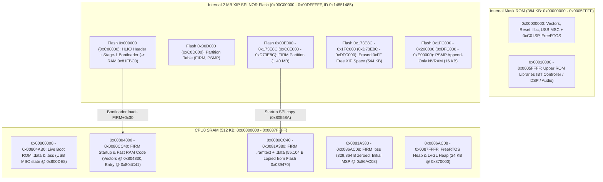

# Smartlink SL6801 (`HW_76` / `pen133_2.0.65`) — Firmware Disassembly & USB/Bluetooth Interaction Reference

This document synthesizes a clean-room binary and Thumb-2 disassembly analysis of the dumped flash image ([dumps/firmware_2M.bin](dumps/firmware_2M.bin)), internal mask ROM dump ([dumps/bootrom_64K.bin](dumps/bootrom_64K.bin)), and SD volume backup (`dumps/sdcard_backup/`), focused on **making sense of the firmware architecture** and **interacting with the device over USB and Bluetooth**.

> [!NOTE]
> Device-specific identifiers (the unit's Bluetooth MAC, factory serial string, and paired-device MAC addresses) are redacted in this public repository (`XX:XX:XX:XX:XX:xx`). Read the live values from your own dump's `PSMP` partition (see §2) or via `bluetoothctl`.

> The exploratory one-off scripts that produced this analysis (PSMP parser, `llvm-objdump` ELF-wrapper disassemblers, string/xref scanners) are preserved in [`tools/fw_analysis/`](tools/fw_analysis/).

---

## 1. Dual-Core SoC, Boot ROM & Complete Memory Map

Disassembling the Boot ROM reset vector (`0x00000040` in [bootrom_64K.bin](dumps/bootrom_64K.bin)) and the `FIRM` startup code (`0x00804C40` / `0x0080555C` in [firmware_2M.bin](dumps/firmware_2M.bin)) reveals several previously undocumented architectural details of the **Smartlink SL6801**:

1. **Hardware Dual-Core Dispatch (`0x4000000C`):**
   * At reset (`0x00000068`), the Boot ROM reads `*(uint32_t *)0x4000000C` (`CPU_ID`):
     * **`CPU0` (`== 0`):** Application, FreeRTOS, LVGL UI, FatFs, USB, and Bluetooth Host (`spark_bt_*`) Cortex-M4F core. Initializes Boot ROM `.data` (`0x00800000..0x008006B4` from ROM `0x0005B800`) and zeroes Boot ROM `.bss` (`0x00800800..0x00804AB0`).
     * **`CPU1` (`!= 0`):** Bluetooth Baseband/Controller (`btc`) & DSP co-processor. Reads the entry pointer from mailbox `*(uint32_t *)0x30000600` (CPU1 SRAM `0x30000000`) and branches directly to it (`bx r0`).
2. **True Internal Mask ROM Size (`384 KB`, not `64 KB`):**
   * `FIRM` contains **273 distinct `BL`/`B.W` targets** into ROM (`< 0x00100000`), of which **148 lie above `0x00010000`** (clustering up to `0x0004C2CB` for exception vectors and **`0x0005B800`** for the Boot ROM `.data` load image).
   * [bootrom_64K.bin](dumps/bootrom_64K.bin) (`0x00000000..0x0000FFFF`) captures the reset startup, libc helpers (`rom_printf` `0x2B0`, `strlen` `0xAA2`, `strcmp` `0xAB2`, `memcpy` `0xB2A`, `memset` `0xBAA`, `memcmp` `0xC54`, `atoi` `0xD1E`), **the entire USB Device + USB Host Mass Storage stack (`0x4E00..0x8500`)**, and FreeRTOS kernel primitives (`SVC_Handler` `0xB4F4`, `SysTick_Handler` `0xB5A8`).

> [!TIP]
> You can dump the full **384 KB** mask ROM (`0x00000000..0x0005FFFF`) in normal Card Reader mode without opening the device:
> ```bash
> sudo /tmp/smartlink_flash/smtlink_dump --id 301a:2801 read_mem 0 384K dumps/bootrom_384K.bin
> ```

### Complete Runtime Address Map (`pen133_2.0.65`)



### Inside `FIRM` (`0x00E000..0x173E8C`)
| Flash Offset | Memory VMA | Size | Description |
| :--- | :--- | :--- | :--- |
| `0x00E000` | `0x00C0E000` | `0x000030` | `FIRM` header (`hdr=0x30`, BCD build timestamp `0x95904A60` / string `2509261408`, `load=0x804C00`, `entry=0x804C01`, `ram_size=0x1000`, `ram_crc=0x4724`) |
| `0x00E030` | `0x00804800` | `0x00AA5E` | Vector table, `Reset_Handler`, fast IRQ/RTOS/DMA routines |
| `0x018A8E` | *(reserved)* | `0x0209E2` | 133 KB zero-padded linker reservation (`FIRM+0x000030` to `FIRM+0x02B440` fixed `0x2B440` slot) |
| `0x039470` | `0x0080CC40` | `0x00D740` | **`.ramtext` + `.data` load image** (`VMA = flash_offset + 0x7D37D0`): holds SDIO (`HAL_sd_disk_read` at `0x8160C8`), USB MSC `ops` (`0x812A00..0x812E60`), LVGL fonts, and initialized globals |
| `0x048030` | `0x00C48030` | `0x07FD00` | XIP `.rodata`: debug format strings, 10-language UI string tables (`0x051000..0x055A3B`), LVGL images/icons (`0x09E000..0x0AA000`), GBK/Unicode tables |
| `0x0C8000` | `0x00CC8000` | `0x0ABE8C` | XIP `.text`: OAL/FreeRTOS wrappers, UI pages & presenters (`0xCE0000..0xD28000`), LVGL v8.3 (`0xD28000..0xD40000`), `PSMP` NVRAM (`0xD40480..0xD42000`), `/dev/*` drivers, FatFs exFAT (`0xD55000..`), and **`spark_bt_*` Bluetooth Host Stack (`0xD60000..0xD68000` + `0x0D6700..0x0DD400` logs)** |

---

## 2. `PSMP` NVRAM Format & Decoded Device Secrets (`0x1FC000`)

The 16 KB `PSMP` partition (`0x1FC000..0x200000`, 4 × 4 KB sectors) is a wear-leveled, append-only key-value store managed by `nv_get` (`0xD41E4C`), `nv_set` (`0xD41DDC`), and `nv_del` (`0xD41B16`).

### Record Binary Layout (`12 + key_len + val_len` bytes)
| Offset | Type | Field | Description |
| :--- | :--- | :--- | :--- |
| `+0x00` | `u16` | `magic` | Always `0xAA55` (`55 AA` on disk) |
| `+0x02` | `u8` | `status` | `0xFF` = **Active**, `0xFE` = **Obsolete** (cleared in-place on SPI NOR without sector erase when a new value is appended) |
| `+0x03` | `u32` | `crc32` | Raw IEEE 802.3 CRC-32 (`poly=0xEDB88320`, **`init=0x00000000`, `final_xor=0x00000000`**) computed over `key || val || header_12B` (with `header[2]=0xFF` and `header[3..6]=0xFFFFFFFF`) |
| `+0x07` | `u16` | `val_len` | Value byte length |
| `+0x09` | `u16` | `key_id` | Numeric key index (`1..15`) |
| `+0x0B` | `u8` | `key_len` | ASCII key name length (no NUL terminator) |
| `+0x0C` | `char[]` | `key` | Key string (`bt_addr`, `bt_name`, etc.) |
| `+0x0C+key_len` | `u8[]` | `val` | Raw value payload |

### Active Records in Your Dumped `firmware_2M.bin`
| ID | Key | Len | Value in Dump & Decoded Meaning |
| :--- | :--- | :--- | :--- |
| `1` | `bt_addr` | 6 | `xx xx xx xx xx 76` (little-endian) → Classic BT MAC **`XX:XX:XX:XX:XX:76`** |
| `2` | `device_id` | 64 | `'CBKJ01RECPENMP3-------T90081----------XXXXXXXXXX76064091--------'` (Factory serial/model string embedding MAC `XXXXXXXXXX76`) |
| `3` | `freq_drift` | 2 | `0x0049` (`73`) — RF crystal calibration trim |
| `4` | `profile` | 4 | `00 02 00 00` — System UI/backlight/power settings |
| `5` | `pass` | 4 | `00 00 63 63` — Power-on password disabled (`00 00`) |
| `6` | `record` | 28 | Voice recorder settings: `kbps_mode = 0` (**512 kbps**, 16 kHz 16-bit stereo), `segment_mode = 3` (**120 min**), scheduled start `08:30` / end `09:30`, monitor/denoise/VAD flags (see §9.2) |
| `7` | `music` | 20 | Last played track (`#1`, pos `45s`, play mode `4`) |
| `8` | `audio_volume` | 16 | Four `u32` gains: speaker/headphone volume `10`, `100`, `90`, `90` |
| `9` | `voltage` | 4 | `0x0104` (`260`), `100%` battery state |
| `10` | `bt_name` | 64 | `'HW_76\0...'` — **Editable Bluetooth broadcast name** (initialized from `HW_` + `bt_addr[0]`) |
| `11` | `bt_info` | 1 | `0x00` = BT Off (`0x01` = **`music mode`** A2DP Source, `0x02` = **`phone mode`** HFP Hands-Free) |
| `12` | `btlinknum` | 4 | `2` paired Bluetooth devices stored |
| `13` | `btlinkinfo` | 192 | Two 96-byte pairing slots (`flags[4]`, `bd_addr_le[6]`, `key_type[2]=0x0004`, **`link_key[16]`**, `remote_name[64]`, `cod[4]=0x00240404`):<br>• Slot 0: `XX:XX:XX:XX:XX:5C` (`"SLANG-M5 Armored Cavalry"`)<br>• Slot 1: `XX:XX:XX:XX:XX:EB` (`"Jabra Hear Me Out"`) |
| `14` | `btrlk` | 6 | `xx xx xx xx xx eb` → Last-connected headphone MAC `XX:XX:XX:XX:XX:EB` |
| `15` | `language` | 2 | `0x0000` |

> [!NOTE]
> **Minor RIFF WAV Header Quirk in Recordings (`dumps/sdcard_backup/record/*.wav`):**
> The four `*-120min.wav` files in `0:\record` are uncompressed `PCM_S16LE` (`fmt=0x0001`), **2 channels, 16,000 Hz**, `byteRate = 64,000 B/s`, `bitsPerSample = 16`, but the firmware writes **`blockAlign = 2` instead of `4`** (`channels * bitsPerSample / 8`). Standard tools (`ffmpeg`, `aplay`, `sox`) play them fine, though strict RIFF validators may warn unless `blockAlign` at file offset `0x20` is patched to `0x0004`.

---

## 3. Interacting via USB (`301a:2801` & `301a:2800`)

### 3.1 USB Architecture & Plug-In Behavior
The device implements **only** USB 2.0 Full-Speed **Mass Storage Bulk-Only Transport (`bInterfaceClass = 0x08`, Bulk-Only `0x50`)** — there are no hidden composite HID, CDC-ACM serial, USB Audio, or MTP descriptors in either `BootROM` or `FIRM`.

When VBUS is detected during normal operation (`pstr_usb_option_process`):
* The screen prompts **`Charge & Transfer`** vs **`Charge & Play`**.
* Selecting **`Charge & Transfer`** closes Bluetooth (`USB reader, close bt`), disables local recording, calls `usbd_msc_cardreader_init` (`0xD3A580`), registers `FIRM`'s `ops` table (`0x812A00..0x812AD9`) into Boot ROM's USB MSC state via `usb_set_userfn` (`0x5914` -> `*(0x801068)`), and enumerates as **`301a:2801`** (`SMTLINK CARDREADER 1.00`).
* Selecting **Settings → Update Options → `PC Upgrade`** sets a PMU flag (`HAL_pmu_pc_update_flag_set`) and reboots into the Bootloader's USB update mode (**`301a:2800`**, no hardware boot-key press needed).

### 3.2 Exact Instruction-Level Root Cause & Firmware Fix for the 15s Linux Disconnect Loop
Disassembling `FIRM`'s SCSI CDB interceptor (`0x812AD8`), `HAL_sd_disk_read` (`0x8160C8`, flash `0x0428F8`), and `sd_read_blocks` (`0x815BF0`, flash `0x042420`) pinpoints **two interlocking bugs** when Linux probes the final 4 KiB (`LBA 122,101,752..122,101,759`) in 1-sector (`count = 1`) USB MSC reads:

1. `FIRM` intercepts SCSI `0x28` (`READ(10)`), `0x2A` (`WRITE(10)`), and `0x1B` (`START STOP UNIT`) at `0x812AD8` (splitting every `READ(10)` into 1-sector calls to `HAL_sd_disk_read`, and zeroing MBR entries 2–4 in RAM whenever `LBA == 0` is read at `0x812BD2`).
2. `HAL_sd_disk_read` uses a matched entry (`0x816128`) / exit (`0x8161F0`) pair comparing against `total_sectors - 3` (`122,101,757 = 0x07471FFD`) to temporarily switch from `read_mode = 1` (open-ended streaming `CMD18`) to `read_mode = 2` (finite `CMD18` + hardware `AUTO_CMD12`, clamped to `min(8, total_sectors - r5)` sectors) on the last 3 sectors.
3. **Bug #1 — Off-by-one on post-incremented `r5` (`0x8161FA`):** When reading `LBA = 122,101,756` (`total_sectors - 4`, `count = 1`), entry keeps `read_mode = 1` (open-ended `CMD18`, card stays in `DATA` streaming state), then `0x816244` increments `r5` to `122,101,757`. At exit (`0x8161FA`), `cmp (total_sectors - 3), r5` is equal, so `bhi 0x8162cc` is NOT taken and `0x81620E` **erroneously sets `skip_cmd12` (`[r4+0xd0] = 1`)** while the card is still actively streaming!
4. **Bug #2 — Illegal `CMD18` in `DATA` state (`0x815C22`):** On the immediately following read at **`LBA = 122,101,757`** (`total_sectors - 3`), entry switches `read_mode = 2` and calls `sd_read_blocks(r4, cache_buf, 122101757, 3)`. Because `122,101,757 == next_expected_lba` (`[r4+0x98]`), `0x815C1E` skips the `CMD12` stop check and falls directly into `0x815B38`, **issuing a new `CMD18` (`AUTO_CMD12`) to an SD card still in `DATA` state without sending `CMD12` first** — wedging the SDIO bus until Linux's 15-second `usb-storage` timeout resets the port.
5. **Two Ways to Fix It:**
   * **Host-side (no flashing):** [50-smartlink-sl6801.rules](50-smartlink-sl6801.rules) + `-1 cluster` shrink in [fix_exfat_boundary.py](tools/fix_exfat_boundary.py) keeps `udevd` and `fwupd` below `total_sectors - 256`.
   * **Direct Firmware Patch (`--patch sdio-end-of-disk` in [tools/patch_firmware.py](tools/patch_firmware.py)):** Two `llvm-objdump`-verified hunks (34 bytes total in `.ramtext`):
     * **Hunk 1 (`0x815C22`, flash `0x042452`, 6 B):** On sequential reads, only continue streaming if `read_mode == 1`; otherwise branch to `0x815C4C` so `CMD12` is sent before issuing finite `CMD18`.
     * **Hunk 2 (`0x8161F0`, flash `0x042A20`, 28 B):** Check `[r4+0x38] == 2` (actual mode switch) instead of post-incremented `r5 >= total_sectors - 3`, and verify `[r4+0x98] >= r5` before setting `skip_cmd12 = 1` (preventing cache-hit corruption too). Fixes Linux USB on **any** SD card without shrinking partitions!

### 3.3 Full USB SCSI & Vendor `0xC0` Command Table
Because `FIRM`'s `ops + 0x20` (`0x812AD8`) only intercepts `0x1B`, `0x28`, and `0x2A`, and returns `0` for everything else, **Boot ROM's entire `0xC0` vendor SCSI command engine (`0x61DE`) remains live in normal `301a:2801` Card Reader mode** as well as `301a:2800` Bootloader mode!

All vendor commands use standard 31-byte USB MSC CBW (`USBC`, `0x43425355`) with a 16-byte CDB:
* `CDB[0] = 0xC0`
* `CDB[1] = subcmd`
* `CDB[2..5] = arg1` (`uint32_le`, usually byte length)
* `CDB[6..9] = arg2` (`uint32_le`, flash offset or 32-bit memory/function address)

| `CDB[1]` | Name | Direction | `arg1` (`CDB[2..5]`) | `arg2` (`CDB[6..9]`) | Behavior in `BootROM` (`0x61DE`) |
| :--- | :--- | :--- | :--- | :--- | :--- |
| `0x00` | `READID` | IN (`4B`) | `4` | `0` | Reads 4-byte SPI NOR Flash ID (`0x14851485`) via `0x8246` |
| `0x02` | `WRITEPAGE` | OUT (`len`) | `len` (`0x1000`) | `flash_off` | Programs SPI NOR flash from Bulk-OUT data (`0x60F8` → `0x84A8`) |
| `0x03` | `ERASE4K` | NONE | `0x1000` | `flash_off` | Erases 4 KB SPI NOR sector |
| `0x04` | `ERASE32K` | NONE | `0x8000` | `flash_off` | Erases 32 KB SPI NOR block |
| `0x05` | `ERASE64K` | NONE | `0x10000` | `flash_off` | Erases 64 KB SPI NOR block |
| `0x06` | `ERASECHIP` | NONE | `0` | `0` | Full SPI NOR chip erase |
| `0x07` / `0x08` | `READ` / `FASTREAD` | IN (`len`) | `len` (`<=4096`) | `flash_off` | Reads raw SPI NOR flash (`0x000000..0x1FFFFF`) |
| `0x09` | `WRITERAM` | OUT (`len`) | `len` | `ram_addr` | Writes Bulk-OUT bytes directly to arbitrary SRAM (`ram_addr`) |
| `0x0A` | `RUNRAM` | IN/NONE | user `u32` | `func_addr \| 1` | Calls `((void (*)(void))(func_addr \| 1))()` (`bx r3` at `0x61DC`); if IN `data_len > 0`, returns `[0x800DF0 .. +len]` before `USBS` |
| `0x81` | `INIT` | NONE | `2` | `0` | Initializes SPI NOR controller/clocks (`0x8140`) |
| `0x82` | `CRC` | IN (`2B`) | `len` | `flash_off` | Computes `CRC-16/CCITT-FALSE` over flash range (`0x81BE`) |
| `0x86` / `0x87` | `NOP` / `PING` | NONE | `0` | `0` | Returns `USBS` status `0` immediately |

> [!WARNING]
> While `WRITEPAGE` (`0x02`) and `ERASE4K` (`0x03`) exist in the ROM handler even in `301a:2801` mode, `FIRM` executes in-place (XIP) from SPI NOR flash (`0x00C00000+`). **Never erase/write `FIRM` sectors while running in `301a:2801` mode** — always enter `301a:2800` Bootloader mode (via **Settings → Update Options → PC Upgrade** or the hardware boot key) before flashing! Updating `0:\update.up` on the mounted exFAT volume is also supported by the bootloader (`0x82BC2E`).

### 3.4 Three Ways to Interact via USB from Linux
1. **Standard Filesystem Access (Recordings, Music, Media DB, `0:\update.up`):**
   * With [50-smartlink-sl6801.rules](50-smartlink-sl6801.rules) and the `-1 cluster` exFAT boundary shrink applied, mount `/dev/sdX1` normally to pull WAV recordings from `record/`, manage audio/video/ebooks, or inspect `DBROOT/db_wave.db`.
2. **Direct Vendor `0xC0` USB Tooling (`libusb` / Python `pyusb`):**
   * Detaching `usb-storage` via `libusb` lets a host script read `PSMP` NVRAM (`read_flash 0x1FC000 16K`) in <50 ms (e.g., to inspect battery voltage, paired BT link keys, or recording settings) or invoke firmware functions in `FIRM` (such as reading/setting `/dev/rtc` via `0xD15070` so recordings always have accurate timestamps!).
3. **Custom XIP App / USB Command Extension:**
   * There is **544 KB of unused `0xFF` XIP flash** at `0x173E8C..0x1FC000` (`0xD73E8C..0xDFC000`).
   * In Boot ROM's `0xC0` dispatcher (`0x621E..0x6234`), **any unknown `CDB[1]` subcommand** (i.e. anything other than `0x00, 0x02..0x0A, 0x81, 0x82, 0x86, 0x87`) automatically calls `FIRM`'s `ops + 0x18` (`0x812A80`, currently a stub `movs r0, #0; bx lr`):
     ```c
     int ret = ops->user_c0_cmd((uint8_t *)0x00800FFF /* CDB pointer */);
     if (ret > 0) { *(uint16_t *)0x00800DEE = 0; return 0; } // success, no IN data
     return (ret == 0) ? 0 : -1;                             // 0 = send tx_len bytes from 0x800DF0; <0 = STALL/fail
     ```
   * Custom firmware extensions can therefore cleanly add new `0xC0` subcommands (`CDB[1] = 0x40..0x7F`) for live RPC over USB!

---

## 4. Interacting via Bluetooth (`spark_bt_*` Stack)

### 4.1 What Is (and Isn't) in the Bluetooth Stack
Disassembling the Bluetooth Host stack (`spark_bt_*` at `0xD60000..0xD68000`, SDP records at `0x0D9510`, `0x0DA5B8`, `0x0DAE08`) establishes the exact wireless capabilities of `HW_76`:

* **Radio Type:** **Classic Bluetooth BR/EDR only** (with Secure Simple Pairing / SSP + 16-byte Link Keys stored in `PSMP` `btlinkinfo`). **No BLE / GATT, no SPP (`0x1101`), and no OBEX (`0x1105`/`0x1106`)** exist in the firmware.
* **Two Mutually Exclusive Modes (`bt_info` in `PSMP`, toggled in Bluetooth menu):**

| Mode | UI Name | `bt_info` | Role & SDP Services Registered | Audio Codecs | Control Channel |
| :--- | :--- | :--- | :--- | :--- | :--- |
| **Mode 1** | **`music mode`** | `0x01` | **A2DP Source** (`0x110A` v1.3, L2CAP PSM `0x0019`) + **AVRCP Target** (`0x110C` v1.4, L2CAP PSM `0x0017`); queries remote for Audio Sink (`0x110B`) & AVRCP (`0x110E`) | SBC (`enc.sbc`) | AVRCP Pass-Through (`0x7C`) & Play Status / Volume (`0xD615C0`) |
| **Mode 2** | **`phone mode`** | `0x02` | **HFP Hands-Free Unit** (`0x111E` v1.6, features `0x0035`) + **Generic Audio** (`0x1203`) on **RFCOMM Channel 1**; broadcasts as **`HW_76`** (`XX:XX:XX:XX:XX:76`, CoD `0x280408`) | **mSBC** (16 kHz wideband) & **CVSD** (8 kHz) over SCO/eSCO | HFP AT commands over RFCOMM Ch 1 (`0xD620E6`) |

---

### 4.2 Interacting in `phone mode` (HFP v1.6 — Wireless Mic/Speaker + Remote Recording Trigger!)

In **`phone mode`**, `HW_76` acts as a Bluetooth Hands-Free peripheral waiting for a phone or **Linux PC acting as HFP Audio Gateway (AG)** to connect to **`XX:XX:XX:XX:XX:76` on RFCOMM Channel 1**.

#### Exact HFP Service Level Connection (SLC) & Call Recording Sequence
From `_hfp_hf_slc_open_status` (`0xD627C0`), `pstr_bt_analysis` (`0xCF637C`), and `pstr_page70_record_start` (`0xCF96C8`):

```mermaid
sequenceDiagram
    participant PC as Linux Host (HFP Audio Gateway)
    participant HW as HW_76 (RFCOMM Ch 1 + eSCO)
    participant SD as 0:\record\ on SD Card

    HW->>PC: AT+BRSF=53\r
    PC->>HW: +BRSF: <ag_features>\r\nOK\r\n
    opt If AG advertises Codec Negotiation (bit 7)
        HW->>PC: AT+BAC=1,2\r (1=CVSD 8kHz, 2=mSBC 16kHz)
        PC->>HW: OK\r\n
    end
    HW->>PC: AT+CIND=?\r
    PC->>HW: +CIND: ("service",(0,1)),("call",(0,1)),("callsetup",(0-3)),...\r\nOK\r\n
    HW->>PC: AT+CIND?\r
    PC->>HW: +CIND: 1,0,0,...\r\nOK\r\n
    HW->>PC: AT+CMER=3,0,0,1\r
    PC->>HW: OK\r\n
    Note over PC,HW: SLC_OPEN reached!

    Note over PC,HW: To trigger live audio + automatic SD WAV recording:
    PC->>HW: +CIEV: 2,1\r\n (call = 1 -> "call_online", opens page_call_on)
    opt Wideband mSBC codec selection
        PC->>HW: +BCS: 2\r\n
        HW->>PC: AT+BCS=2\r
        PC->>HW: OK\r\n
    end
    PC->>HW: Open Bluetooth SCO / eSCO Audio Socket
    Note over HW,SD: SCO_OPEN -> PHONERECORD! Automatically opens<br/>0:\record\20YYMMDD-HHMMSS-phone.wav!
    PC<<->>HW: Bidirectional SCO Audio (PC audio -> HW_76 + WAV; HW_76 mic -> PC + WAV)
    PC->>HW: Close SCO + send +CIEV: 2,0\r\n (call = 0 -> "call_end")
    Note over HW,SD: Flushes & saves *-phone.wav to SD card!
```

#### Complete AT Command Vocabulary of `HW_76` (`0xCDAE7C..0xCDAEE0`)
* **Sent by `HW_76` to Host (RFCOMM Ch 1):**
  * Handshake: `AT+BRSF=<feat>\r`, `AT+BAC=1,2\r`, `AT+CIND=?\r`, `AT+CIND?\r`, `AT+CMER=3,0,0,1\r`, `AT+BCS=<id>\r`
  * Call UI buttons (`page_call_come` / `page_call_on`): **`ATA\r`** (user pressed Answer button on recorder!), **`AT+CHUP\r`** (user pressed Hangup/Reject button on recorder!)
  * Gain sync: `AT+VGS=<0..15>\r`, `AT+VGM=<0..15>\r`
* **Parsed by `HW_76` from Host:**
  * `OK`, `ERROR`, `+BRSF:`, `+CIND:`, `+CHLD:`, **`+CIEV:`** (drives `call_income`, `call_ring`, `call_online`, `call_end`), `+BSIR:`, **`RING`**, `+VGM:` / `+VGM=`, `+VGS:` / `+VGS=`, **`+BCS:`** (`1` = CVSD, `2` = mSBC).

#### Practical Ways to Use `phone mode` from Linux:
1. **Zero-Code Wireless Mic/Headset via BlueZ + PipeWire:**
   * Pair with `bluetoothctl` (`scan bredr` → `pair XX:XX:XX:XX:XX:76` → `connect XX:XX:XX:XX:XX:76`). Select the **Handsfree / Headset Head Unit (HFP, mSBC)** profile in PipeWire (`wpctl` / `pavucontrol`) to stream 16 kHz mic audio from `HW_76` into Linux and play Linux audio out of `HW_76`.
2. **Custom Python RFCOMM + SCO Controller (Remote Recording & Button Capture!):**
   * By connecting a Python `AF_BLUETOOTH` (`BTPROTO_RFCOMM` channel 1 + `BTPROTO_SCO`) script directly to `XX:XX:XX:XX:XX:76` (or registering a custom BlueZ `Profile1` HFP AG), your Linux host can:
     * **Remotely start and stop on-device WAV recording** (`0:\record\20YYMMDD-HHMMSS-phone.wav`) on demand simply by sending `+CIEV: 2,1` + opening a SCO socket, and `+CIEV: 2,0` + closing SCO!
     * **Capture physical button presses** (`RING` + `+CIEV: 3,1` puts an incoming-call prompt on `HW_76`'s LCD, and pressing the button sends `ATA\r` or `AT+CHUP\r` to your Python script!).
     * **Stream arbitrary audio directly onto the recorder's SD card** over the SCO link while simultaneously receiving the recorder's microphone feed.

---

### 4.3 Interacting in `music mode` (A2DP Source + AVRCP Remote Control!)

In **`music mode`**, `HW_76` scans for and connects to a Bluetooth audio sink — which can be **your Linux PC** (BlueZ + PipeWire automatically exposes an `Audio Sink` `0x110B` + `AVRCP Controller` `0x110E` when discoverable!).

* **Audio Streaming (`HW_76` → Linux):** Any voice recording (`0:\record\*.wav`) or music track played on `HW_76` streams digitally over A2DP SBC into Linux PipeWire as a standard audio input stream.
* **Remote Controlling `HW_76` from Linux via AVRCP (`0xD61866`):**
  Disassembly of `_avrcp_tg_command_parser` (`0xD61866..0xD61CA6`) shows `HW_76` implements a 12-entry AVRCP Pass-Through (`0x7C`) jump table for `op_id` **`0x41`–`0x4C`**:
  * `0x41` `VOL_UP`, `0x42` `VOL_DOWN`, `0x43` `MUTE`
  * `0x44` **`PLAY`**, `0x45` **`STOP`**, `0x46` **`PAUSE`**
  * `0x47` **`RECORD`**, `0x48` **`REWIND`**, `0x49` **`FAST_FORWARD`**
  * `0x4B` **`FORWARD` (Next File)**, `0x4C` **`BACKWARD` (Previous File)**
  * Plus `GetPlayStatus` (`PDU 0x30` at `0xD61834` — returns total track length & current playback position in ms!) and `RegisterNotification` (`PDU 0x31` at `0xD61844`).
  * On Linux, once `HW_76` connects in `music mode`, you can control it directly via **`playerctl`** or D-Bus (`org.bluez.MediaPlayer1` / `MediaControl1`: `Play`, `Pause`, `Stop`, `Next`, `Previous`)!

---

## 5. Bootloader Integrity, `0:\update.up` Protocol & Binary Patching

Disassembling the Stage-1 Bootloader (`0x000060..0x00C950`, loaded to SRAM `0x0081FBC0`, entry `0x00820001`) reveals **no cryptographic signature verification anywhere in the boot or update path**. All integrity fields use plain **`CRC-16/CCITT-FALSE`** (`poly=0x1021`, `init=0xFFFF`, `xorout=0x0000`), verified against `dumps/firmware_2M.bin`:

| Structure | Flash Range | Checksum Field | Stored & Computed CRC-16 |
| :--- | :--- | :--- | :--- |
| **`HLKJ` Boot Header** | `0x000000..0x00005B` | `0x00005C` (`u16`) | `0xC1E7` (exact match) |
| **Stage-1 Bootloader** | `0x000060..0x00C94F` (`0xC8F0` B) | `0x000014` (`u16`) | `0x3244` (exact match) |
| **`FIRM` Initial RAM Block** | `0x00E030..0x00F02F` (`0x1000` B) | `0x00E01C` (`u16`) | `0x4724` (exact match) |
| **Entire `FIRM` Partition** | `0x00E000..0x173E8B` (`0x165E8C` B) | `0x00D01C` (`u16`, partition table) | `0xBDA3` (exact match) |

### 5.1 Normal Boot (`0x820470..0x8204D6`)
* The bootloader reads `FIRM` header fields (`loadToRam = 0x804C00`, `runFromRam = 0x804C01`, `loadLength = 0x1000`), copies `0x1000` bytes from flash `0x00E030` to SRAM `0x804C00` via `0x820A64`, logs `boot--->firmware_header_len ...`, and immediately executes **`blx r6`** (`0x8204D0`) without re-checking `loadCrc` at boot.

### 5.2 SD-Card Update Format (`0:\update.up`, `sdupdate` at `0x827854..0x827BD4`)
Triggered when `HAL_pmu_sd_update_flag_set` is active and `0:\update.up` exists on the SD card:
1. Reads the first `0x200` bytes and validates two ASCII magic fields:
   * `+0x00`: `"CONFI"` (5 bytes checked; fails with `0xFE`)
   * `+0x06`: `codeOffsetInByte` (`u32_le`, byte offset in `update.up` where the raw flash image starts)
   * `+0x16`: `"SL6801"` (6 bytes checked; fails with `0xFA`)
2. Reads `partition_start` from the current flash's `HLKJ` header at `0x000020` (`0x0000D000`; defaults to `0x3000` if zero).
3. Erases 4 KB sectors starting at `partition_start` (`0xD000`) — **never touching the Stage-1 Bootloader (`0x0000..0xCFFF`) or `PSMP` NVRAM (`0x1FC000..0x200000`)** as long as the image ends below `0x1FC000`.
4. Programs 512-byte chunks (as two 256-byte SPI NOR pages via `0x821FFC`) while accumulating a running 16-bit CRC (`0x821F84`, init `0xFFFF`), then reads back all written sectors and compares the read-back CRC (`crc cmp %x %x`).

---

## 6. WAV/ADPCM Recording Pipeline & Exact Binary Patches

Disassembling `WriteWav` (`0xCED1F4`) and `CloseWav` (`0xCED32C`, flash `0x0ED32C`) shows that the recorder supports both **uncompressed PCM (`wFormatTag = 0x0001`, 44-byte header)** and **IMA-ADPCM (`wFormatTag = 0x0011`, 60-byte header with `fact` chunk when codec == `"adpc"`)**.

### 6.1 Exact Instruction-Level Root Cause & In-Place Patch for WAV `blockAlign = 2`
In the PCM WAV header builder (`0xCED45C..0xCED478`, flash `0x0ED45C..0x0ED478`, where `sp + 0x0C` is the start of the 44-byte RIFF header):
```armasm
ced464: 7bd2         ldrb   r2, [r2, #0xf]   @ r2 = bytesPerSample (2)
ced466: 4350         muls   r0, r2, r0       @ r0 = bytesPerSample * sampleRate
ced468: b292         uxth   r2, r2           @ redundant zero-extend
ced46a: 4343         muls   r3, r0, r3       @ r3 = nAvgBytesPerSec (64000)
ced46c: f8ad 202c    strh.w r2, [sp, #0x2c]  @ BUG: stores bytesPerSample (2) as nBlockAlign!
ced470: 00d2         lsls   r2, r2, #0x3     @ r2 = wBitsPerSample (16)
ced472: 930a         str    r3, [sp, #0x28]  @ nAvgBytesPerSec
ced474: f8ad 202e    strh.w r2, [sp, #0x2e]  @ wBitsPerSample
```
Because `nAvgBytesPerSec == nBlockAlign * nSamplesPerSec`, this can be fixed cleanly in-place (exact same 20 bytes at flash `0x0ED464..0x0ED477`, followed by recomputing partition CRC-16 at `0x00D01C` — automated by [tools/patch_firmware.py](tools/patch_firmware.py) `--patch wav-blockalign`):
```armasm
ced464: 7bd2         ldrb   r2, [r2, #0xf]   @ r2 = bytesPerSample
ced466: 4353         muls   r3, r2, r3       @ r3 = bytesPerSample * nChannels (nBlockAlign = 4!)
ced468: 4358         muls   r0, r3, r0       @ r0 = nBlockAlign * sampleRate (nAvgBytesPerSec)
ced46a: f8ad 302c    strh.w r3, [sp, #0x2c]  @ nBlockAlign = 4
ced46e: 00d2         lsls   r2, r2, #0x3     @ r2 = wBitsPerSample (16)
ced470: 900a         str    r0, [sp, #0x28]  @ nAvgBytesPerSec
ced472: f8ad 202e    strh.w r2, [sp, #0x2e]  @ wBitsPerSample
ced476: bf00         nop                     @ 2-byte pad
```

---

## 7. Hardware Peripherals, `/dev/rtc` Struct & USB Clock Sync

`FIRM` registers a POSIX-like `/dev/*` table including `/dev/audio0`, `/dev/audio1`, `/dev/lcd`, `/dev/tp`, `/dev/rtc`, `/dev/timer`, `/dev/pmu`, `/dev/wdog`, `/dev/sd`, `/dev/usbd`, `/dev/uart0..2`, `/dev/kadc_ch0..5`, `/dev/key_onoff`, `/dev/key_io`, `/dev/exti`, and `/dev/pwm_ch0..5`.

### `/dev/rtc` Binary Layout & Direct HAL Entry Points (`0xD3B40C` / `0xD3B488`)
Both `/dev/rtc` (`read`/`write` require `len >= 10`) and FatFs `get_fattime` (`0xD15084`) use a packed **10-byte `rtc_time_t`** struct:

| Offset | Type | Field | Notes |
| :--- | :--- | :--- | :--- |
| `+0x00` | `u16` | `year` | Years since **2000** (e.g., `26` for `2026`; `rtc_write` adds `2000` for Zeller's congruence, `get_fattime` adds `20` for FAT 1980 epoch) |
| `+0x02` | `u8` | `month` | `1..12` |
| `+0x03` | `u8` | `day` | `1..31` |
| `+0x04` | `u16` | `weekday` | `0..6` (auto-computed by `/dev/rtc` write at `0xD3B424..0xD3B474`) |
| `+0x06` | `u8` | `hour` | `0..23` |
| `+0x07` | `u8` | `minute` | `0..59` |
| `+0x08` | `u8` | `second` | `0..59` |
| `+0x09` | `u8` | `pad` | `0` |

* **`HAL_rtc_get(rtc_time_t *out)`:** `0x0080D4E4` (in `.ramtext`, pure lock-free MMIO read via `*(uint32_t *)0x81A430`)
* **`HAL_rtc_set(const rtc_time_t *in)`:** `0x00CE88D4` → `0x00CE898C` (pure lock-free MMIO write; automatically computes leap-year bit 24)
* **Cached RAM copy:** `0x00821216` (refreshed every 1000 ms by `sync_rtc` timer `0xD15030`)
* **Zero-flash USB RTC Sync ([tools/usb_rtc_sync.py](tools/usb_rtc_sync.py)):** In normal `301a:2801` Card Reader mode, `usb_rtc_sync.py` writes a 20–28 byte Thumb-2 stub into the unused upper half of Boot ROM's 512-byte USB MSC data buffer (`0x00800E80`) via `0xC0` `WRITERAM` (`0x09`) and executes it via `RUNRAM` (`0x0A`), setting `*(uint16_t *)0x00800DEE = 10` on reads to return the live `rtc_time_t` from `0x00800DF0` without modifying flash.

---

## 8. CPU1 Co-Processor Boot & Mailbox (`0xCE7370..0xCE73CC`)

`FIRM` boots CPU1 (`0xCE73A8`) through three 32-bit mailbox words in CPU1 SRAM (`0x30000600`):
1. `*(uint32_t *)0x30000600 = 0x00CE7371` — CPU1 trampoline address (read by Boot ROM when `CPU_ID != 0`).
2. `*(uint32_t *)0x30000604 = cfg->stack` — initial `SP` for CPU1.
3. `*(uint32_t *)0x30000608 = cfg->entry` — CPU1 payload entry point.
4. Calls Boot ROM reset/wake helpers `0x2570(0)` and `0x2564(0)`.

On wake, CPU1 executes the trampoline at `0x00CE7370`, sets `SP` from `0x30000604`, enables the **Cortex-M4F FPU** (`CPACR` `0xE000ED88 |= 0x00F00000`, confirming CPU1 is also a Cortex-M4F with FPU), writes `0x8` to `0x40000060`, and branches to `*(uint32_t *)0x30000608`.

---

## 9. Audio Capture, DSP & `PHONERECORD` Pipeline

### 9.1 `/dev/audio0` (DAC) & `/dev/audio1` (ADC) Unified Driver (`0x00D3A6E8..0x00D3ABFC`)
Both `/dev/audio0` (`0x00CB9A3C`, `arg=0`) and `/dev/audio1` (`0x00CB9A48`, `arg=1`) share a single factory function `audio_dev_init(uint32_t dev_id)` at **`0x00D3A984`** (flash `0x13A984`), which allocates a `0x7C`-byte handle and configures the codec via `HAL_audio_ioctl(1, cmd, val)` (`0x00D3C186`) and `HAL_audio_open(1, dir, cfg)` (`0x00D3C1B2`):

| Device | `dev_id` | Vtable (`open`, `close`, `read`/`write`, `ioctl`) | Key Hardware Behavior |
| :--- | :--- | :--- | :--- |
| **`/dev/audio0`** (Playback / DAC) | `0` | `open=0xD3AAC1`, `close=0xD3A941`, `write=0xD3A911`, `ioctl=0xD3A6E9` | Defaults `AMIC1_GAIN=28` (`0x1C`), `AMIC2_GAIN=84` (`0x54`). On `open`: if `sample_rate <= 16000`, instantiates an upsampler (`0xD3BE44`) to **48,000 Hz**; if `channels == 1`, enables `mono_to_stereo` (`+0x74 = 1`) with a stereo-duplication buffer (`+0x78`). Opens DAC via `HAL_audio_open(1, 1, cfg)`. |
| **`/dev/audio1`** (Capture / ADC) | `1` | `open=0xD3A7A9`, `close=0xD3A78D`, `read=0xD3A6ED` (`b.w 0x813604`), `ioctl=0xD3A6E9` | On `open` (2 ch): uses default `AMIC1_GAIN=28` / `AMIC2_GAIN=84` if `[handle+0x3C]==0`, or scales `AMIC1_GAIN = gain * 1.5` and `AMIC2_GAIN = gain * 2.0`. Enables ADC bias (`0x60=1`, `0x5F=1`), routes mic input via `mic_sel` (`0xD3A6F2`), and opens ADC via `HAL_audio_open(1, 2, cfg)`. |

* Higher-level `audio_crab` plugins (`reader.pcm` / `recopcm` at `0x00D3DD70`, `writer.pcm` / `spkr` at `0x00D3DE40`) wrap `/dev/audio1` and `/dev/audio0`; `writer.pcm` also opens `/dev/exti` (`0x00D3DEDC`) for headphone-jack presence detection (`earphoone_exist`).

### 9.2 `PSMP` `record` Struct (28 Bytes) & Bitrate / Sample-Rate Table (`0x00CEFD08`)
The recording config builder **`0x00CEFD08`** (flash `0x0EFD08`, reading cached `PSMP` `record` from RAM `0x0081B9C8`) decodes the exact 28-byte `record` struct:

| Offset | Type | Field | Dump Value | Meaning |
| :--- | :--- | :--- | :--- | :--- |
| `+0x00` | `u8` | `kbps_mode` | `0x00` | `0` = **512 kbps**, `1` = **1536 kbps**, `2` = **3072 kbps** |
| `+0x01` | `u8` | `monitor` | `0x00` | `1` = Enable headphone monitoring (`flags |= 0x0C` vs `0x04`) |
| `+0x02` | `u8` | `denoise` | `0x00` | Noise-reduction / ENC level (`0` = off; presets `2`, `3`, `4` in `0xD16CF0`) |
| `+0x03` | `u8` | `segment_mode` | `0x03` | File split duration index (`3` = **120 min**, producing `*-120min.wav`) |
| `+0x04` | `u8` | `vad_enable` | `0x00` | `1` = Enable VAD (`flags |= 0x10`; **only honored when `kbps_mode == 0`**) |
| `+0x08` | `u16[2]` | `sched_start` | `8, 30` | Scheduled recording start (`08:30`) |
| `+0x0C` | `u16[2]` | `sched_end` | `9, 30` | Scheduled recording end (`09:30`) |
| `+0x14` | `u8` | `extra_flag` | `0x01` | `1` = Sets `flags |= 0x40` (**only honored when `kbps_mode == 0`**) |
| `+0x18` | `u32` | `param_18` | `0` | Copied to `[cfg + 0x0C]` |

| `kbps_mode` | UI Label | Packed Format (`[cfg+0x1C]`) | Sample Rate | Ch | Bit Depth | Bitrate | Mic Gain | VAD Allowed |
| :--- | :--- | :--- | :--- | :--- | :--- | :--- | :--- | :--- |
| **`0`** | `512kbps` | `0x02023E80` | `16,000 Hz` | 2 | 16-bit | **512 kbps** | `0x22` (`34`) | Yes |
| **`1`** | `1536kbps` | `0x0202BB80` | `48,000 Hz` | 2 | 16-bit | **1536 kbps** | `0x24` (`36`) | No |
| **`2`** | `3072kbps` | `0x0402BB80` | `48,000 Hz` | 2 | 32-bit | **3072 kbps** | `0x24` (`36`) | No |

### 9.3 DSP: VAD (`enc.vad`), Denoise (ENC/AENC), TX AGC & TX EQ
* **VAD (`enc.vad`, `0x00CECC64..0x00CECE28`):** Allocates a `0x6460`-byte context with a **24-frame × 512-byte (12 KB) pre-roll ring buffer** at `+0x60`. Opens the XIP VAD engine (`0x00D6BB94`, `frame_samples=128`) with `-40` / `-20` dBFS thresholds (`0x00D6C154`, cmd `0x1002`), downmixes stereo to mono (`0x000012D4`), and tracks speech via a **30-bit sliding hangover bitmask** at `[ctx+0x58]`.
* **Denoise (ENC/AENC) + TX AGC + 4-Band TX EQ (`0x00D16CF0..0x00D17200`):** Configures the DSP via `0x00D6CFE8` / `0x00D6CF42` with ioctls `0xA800` (AENC/ENC noise suppression, `-15`/`-20` dB, `+6`/`+9` dB), `0xA801` (TX AGC), and `0xA802` (4-band TX EQ at `350 / 1500 / 2200 / 3500 Hz`). Recording ENC is initialized at `0x00D16CF0`; HFP Phone AENC at `0x00D16F48(sample_rate)` branches on `8000 Hz` (CVSD) vs `16000 Hz` (mSBC).
* **Dynamic Fast-RAM DSP Overlay (`0x00D40B08..0x00D40B88`):** Loads active DSP kernels from flash (`0x00E030 + offset`) into SRAM **`0x00805C40`** on demand, invoked per frame by the AENC plugin (`0xD3C6CC`).

### 9.4 `PHONERECORD` Bluetooth HFP/SCO Mixing & Recording Path
* During an active HFP SCO call (`PHONEPLAY`, state `0x31`), `0x00D14DC4` sends `audio_crab_control(crab, 0x108, 1, 0, filepath)` to transition into **`PHONERECORD` (state `0x32`)**.
* The HFP plugin (`0x00D3C5CC..0x00D3C710`) processes 768-byte 3-channel 16-bit frames (`ch0` = far-end SCO RX reference, `ch1..2` = dual-mic near-end TX), runs the SRAM AENC/AEC/AGC/EQ kernel (`0x00805C40`), interleaves processed `[RX, TX]` into a 512-byte stereo frame, and pushes it to `call_save_push` (`0x00D40A08`).
* FreeRTOS task **`"call save process"`** (`0x00D40958..0x00D40A04`) performs **Q15 saturating mono summation** of `RX + TX` (`(rx << 15) + (tx << 15)`, clamped to `[-0x40000000, +0x7FFFFFFE]`), duplicates the mixed sample to both L/R channels (dual-mono stereo), and writes it via `writer.wav` (`WriteWav` at `0x00CED1F4`).

---

## 10. Media Database (`0:\DBROOT\db_wave.db` & `db_content.db`)

Verified against `dumps/sdcard_backup/DBROOT/{db_wave.db,db_content.db}` and `FIRM`'s database routines (`0x00D42A1C..0x00D42AC6`, `0x00D47C70..0x00D48258`):

### 10.1 `0:\DBROOT\db_wave.db` — Headerless `N × 510`-Byte Record Array
* **No file header:** Flat array of **`N × 510` (`0x1FE`) bytes** (`N = db_content.wave_count`, hard-capped at **5,000 records** at `0x00D47FAA`).
* **510-Byte Record Layout** (`db_wave_append_record` at `0x00D47C70`):
  * `+0x000` (`char[255]`): NUL-terminated, zero-padded FatFs path (e.g. `"0:\record\20250907-234610-120min.wav"`).
  * `+0x0FF` (`char[255]`): NUL-terminated, zero-padded basename (e.g. `"20250907-234610-120min.wav"`).
* Sorting (`0x00D47E3C`) and deletion (`0x00D4819C`) rewrite via temporary `0:\DBROOT\db_sort.db` followed by `f_unlink` + `f_rename`.

### 10.2 `0:\DBROOT\db_content.db` — Serialized `db_content_t` Master Index (`696` Bytes)
* **Save (`0x00D42A1C`)** writes the entire `0x2B8`-byte (696 B) in-memory `db_content_t` struct verbatim to disk (leaking live XIP/SRAM pointers at `+0x54..+0x5F` and the 600-byte FatFs `FIL` struct at `+0x60..+0x2B7`). **Load (`0x00D42A98`)** safely reads back only the first **`0x4C` (76) bytes**:

| Offset | Size | Field | Value in Dump | Meaning |
| :--- | :--- | :--- | :--- | :--- |
| `+0x00` | `4` | `header_ver` | `0e 02 00 01` | Database header / version bytes |
| `+0x04` | `4` | `dirty_flags` | `0x00000200` | Dirty bitmask (bit 6 `0x40` = `db_wave.db` dirty) |
| `+0x10` | `4` | `free_clst` | `0x000746AB` (`476,843`) | Snapshot of FAT free clusters (compared on boot to detect external USB/SD edits) |
| `+0x2C` | `4` | `wave_count` | `4` | Number of 510-byte records in `db_wave.db` (max `5,000`) |
| `+0x54..+0x5F` | `12` | `callbacks[2], mutex` | `0xD15535`, `0xD1BB29`, `0x8358D0` | Leaked runtime XIP/SRAM pointers (not loaded back) |

---

## 11. Full 384 KB Internal Mask ROM Architecture (`dumps/bootrom_384K.bin`)

### 11.1 Complete ROM Section Map (`0x000000..0x05FFFF`, 393,216 B)

`bootrom_384K.bin[0x000000..0x00FFFF]` is byte-for-byte identical to `bootrom_64K.bin`. The full 384 KB ROM is partitioned into **8 zero-padded sections**:

| Section | ROM Range | Active Size | VFP/FPU | Subsystem & Contents |
| :--- | :--- | :--- | :---: | :--- |
| **S0** | `0x000000..0x00FFFF` | `65,109 B` | `0xB800+` | **Lower Boot ROM:** Vectors, `Reset_Handler` (`0x41`), libc, USB Device/Host MSC + `0xC0` ISP (`0x4E00..0x8500`), SPI NOR, FreeRTOS (`SVC`/`SysTick`), lower DSP helpers |
| **S1** | `0x010000..0x01FFFF` | `65,136 B` | Heavy | **ROM Audio DSP, Decoders & Parsers:** Radix-2 float FFT (`0x0100F0`), hookable `audio_malloc`/`calloc`/`free` (`0x01100C..0x0110C0`), fast `log2f`/`exp2f` (`0x0128D8`), ROM audio decoders (`0x013000..0x01BFFF`), MP4/M4A/ALAC/MP3 (`Xing`) container parsers (`0x01BED0..0x01FE70`) |
| **S2+S3a** | `0x020000..0x0467FF` | `157,696 B` | None | **Bluetooth BR/EDR Controller (`btc`):** Pure integer RivieraWaves-style (`ke_msg`/`ke_mem`) HCI/LMP/LC/Baseband/Sleep controller. Accesses BT MMIO at `0x40020000` (70 refs), `0x40030000` (80 refs), `0x40036000` (51 refs), `0x40031000`, `0x40027000`. |
| **S3b** | `0x046800..0x047FFF` | `5,085 B` | Heavy | **Audio/Speech DSP Tail:** Float DSP routines (`0x0468DA` called from `FIRM 0xD67508`), calling S6 FPU dot-product helpers |
| **S4** | `0x048000..0x04BFFF` | `15,539 B` | Heavy | **FPU Math & Speech/Audio DSP:** Fast `log2f` (`0x048228`), `exp2f` (`0x048268`), RAM-hookable `codec_calloc`/`codec_free` (`0x04B29C`/`0x04B2AC`), 4-wide `vmla.f32` FIR filter (`0x04B896`) |
| **S5** | `0x04C000..0x04FFFF` | `15,334 B` | Tables | **Stage-0 Boot ROM Loader & LUTs:** `rom_delay_loop` (`0x04C014`), default exception/IRQ handlers (`0x04C2C5..0x04C2CD`), Boot ROM `main()` (`0x04C9C8`), `HLKJ` SPI NOR loader (`0x04CC6C`), `log2f`/trig LUTs (`0x04D600..0x04FBE6`) |
| **S6** | `0x050000..0x05B7FF` | `46,787 B` | `0x596C0+` | **Audio Codec Tables & FPU DSP Tail:** MP3 Huffman (`0x0567BE..0x058CCC`) & IMDCT/polyphase tables (`0x0501A4..0x0567BD`), format FourCCs (`WAVE`, `OggS`, `fLaC`, `ftyp`, `MAC ` at `0x059680..0x0596BC`), 8-wide `vmla.f32` dot product (`0x05B24C`) |
| **S7** | `0x05B800..0x05BEB4` | `1,716 B` | Data | **Boot ROM `.data` Load Image (`-> SRAM 0x00800000..0x008006B4`):** 64-entry RAM vector table, USB MSC callback tables (`0x05BCC8..0x05BDC0`), audio parser vtable, SCSI Inquiry `"SMTLINK DEVICE          2.00"` (`0x05BD90`) |

### 11.2 `FIRM` → Upper ROM Cross-Reference Summary
`FIRM` makes **694 calls to 153 distinct upper-ROM targets** (`0x010000..0x05FFFF`), plus a 10-entry `btc` dispatch table in `.ramtext` (`0x00816D20..0x00816D70`):
* **BT Controller (`0x020000..0x0467FF`):** 96 targets / 301 calls (key RAM-patchable thunks: `ke_msg_alloc` `0x0309EC`, `ke_msg_send` `0x030A30`, `ke_msg_free` `0x030A9E`, `btc_int_disable`/`restore` `0x03DE80`/`0x03DE8C`, `ke_malloc`/`free` `0x03DEA4`/`0x03DEB0`).
* **FPU Math & DSP (`0x048000..0x04BCB3`):** 25 targets / 239 calls (`codec_calloc` `0x04B29C`, `codec_free` `0x04B2AC`, `exp2f` `0x048268`, 4-wide FIR `0x04B896`).
* **Audio Allocator, FFT & Parsers (`0x010000..0x01FFFF`):** 30 targets / 151 calls (`audio_malloc`/`calloc`/`free` `0x01100C`/`0x011044`/`0x0110C0`, Radix-2 FFT `0x0100F0`, parser init/free `0x01D634`/`0x01D664`).

### 11.3 Architectural Finding: `btc` Runs on CPU0
* Across the entire 384 KB Mask ROM, the CPU1 mailbox (`0x30000600`) appears **only once** (in lower-ROM `Reset_Handler` at `0x0000A8`). There is no CPU1 firmware image in ROM.
* The entire 154 KB Bluetooth BR/EDR Controller (`0x020000..0x0467FF`) runs directly on **CPU0** under FreeRTOS (`task btc` / `bt_isr_bh` in `FIRM 0xD55312..0xD585D8`). CPU1 is booted exclusively from `FIRM` XIP (`0x00CE73A8` → `0x00CE7371`).

---

## 12. Bluetooth Boot Persistence, RFCOMM MTU/Credits & Remote Control APIs

### 12.1 Bluetooth Boot Persistence (`bt_info` vs `profile`) & Charging Behavior
* **`bt_info` (PSMP key `12`, 1 B, SRAM `0x0081BA04`):** Stores BT power/connection state (`0` = Off, `1` = On/Disconnected, `2` = Connected), **not** music/phone mode. Both power-off (`0x00CEEB08`) and USB `Charge & Transfer` (`0x00CFB7FC`) call `bt_close_stack()` (`0x00D66E3C`), whose `stack_close` callback (`0x00CF5F60`) writes `bt_info = 0` — causing `pstr_bt_nv_read` (`0x00CF0EA0`) to skip `bt_open_stack()` on the next boot.
* **`profile` (PSMP key `9`, 4 B, SRAM `0x0081B80C`):** Stores **`music mode` (`0x0200`) vs `phone mode` (`0x0400`)**, loaded at boot by `bt_subsystem_init` (`0x00CEA0F8`, defaults to `0x400` `phone mode` and persists across reboots).
* **USB Charging (`Charge & Play`):** VBUS plug-in does **not** close Bluetooth; selecting `Charge & Play` (`pstr_select_usb_mode(2)` at `0x00CFB7C8`) or letting the USB prompt time out keeps Bluetooth 100% active while charging.
* **Verified Boot & Security Patches (in [tools/patch_firmware.py](tools/patch_firmware.py)):**
  * **`--patch bt-autoboot`** (`0x00CFBD8A` / flash `0x0FBD8A`, 4 B): `1f f0 a3 ff` (`bl soft_timer_reset("pstr")`) → `78 f0 41 f9` (`bl 0x00D74010` `bt_autoboot_post_welcome`) — calls `bt_open_stack()` strictly *after* `ViewTask` dismisses the `"welcome"` splash screen. *(Note: patching `0x00CF0EC6` fires before `pstr_start_view()` and hangs on `"welcome"`, and `0x400` in `0x00CEA132` forces Music/A2DP mode rather than Phone/HFP mode.)*
  * **`--patch bt-invisible-boot`** (`0x00D5D47A` / flash `0x15D47A`, 4 B): `40 f2 01 13` → `40 f2 01 03` (`page_en=1, inq_en=0`) — boots connectable-only so paired phones reconnect immediately while nearby scans cannot discover `HW_76`.
  * **`--patch bt-pair-menu`** (`0x00CFFA56` / flash `0x0FFA56`, 4 B): `03 f0 85 f9` (`bl page_bt_menu_create`) → `74 f0 e3 fa` (`bl 0x00D74020` `bt_pair_menu_hook`) — opens a 60-second physical-presence pairing window, enables discoverability via `USER_EVT_SET_DISCOVERABLE (0x8004)`, and renders a yellow `PIN: XXXXXX` LVGL banner on the Bluetooth menu LCD.

### 12.2 RFCOMM MTU & Credit-Based Flow Control (`0x00D620E6..0x00D645C4`)
* **TX Ceilings:** `dlci->mtu` is negotiated to **`512` bytes** (`0x200` at `0x00D6429A`), RFCOMM UIH stack buffer (`0x00D633A8`) is `1024` B, L2CAP MTU (`0x00D5EB80`) is `672` B (`0x2A0`), and HCI ACL non-segmenting cap (`0x00D553DE`) is `674` B (`0x2A2`). Up to **`496` bytes** of payload + 12 B `+XREC` header (`508 <= 512` B) is safe per `hfp_rfcomm_send` call.
* **Credit Window (`0x00D63962`):** RFCOMM uses credit-based flow control (`K = 7` initial credits, `dlci->remote_credits` at `[dlci+0x0F]`) with **no TX queue or blocking** — sending when `remote_credits == 0` silently drops the packet. Tight-loop bursts inside the BT task must therefore be capped to **≤ 4 frames** per host ACK (`MAX_BURST_FRAMES = 4`, `4 × 480 = 1,920` B/burst).

### 12.3 Thread-Safe Remote Recording & Status APIs (`+XREC:RECSTART` / `RECSTOP` / `STAT`)
* **Local Stereo Recording Start (`0x00CF07B0`):** `pstr_audio_start_record(const char *basename)` builds `"0:\\record\\<basename>"` and posts `cmd=0x0C` via `xQueueSend` to Media Task ID 8. Handled natively in `BTREADY` (`0x10`) state — records stereo 16/48 kHz WAV while keeping BT HFP connected.
* **Local Stereo Recording Stop (`0x00D1AAD4`):** `media_stop_record_if_active()` posts `cmd=0x0D` directly to Media Task ID 8 (without touching LVGL timers), flushes/closes the WAV, and returns to `BTREADY` (`0x10`).
* **Media Status & Timer:** `media_get_status()` (`0x00D1AB1C`, atomic `ldrb` from `0x0081C718`: `0x10`=`BTREADY`, `0x21`=`RECORDPLAY`, `0x22`=`RECORDPAUSE`); `pstr_audio_get_rec_time()` (`0x00CF04DC`).
* **Live Battery / PMU State (`0x00821222`, lock-free SRAM):** `+0x01` `charge_status` (`0`=discharging, `1`=charging, `2`=full), `+0x02` `vbus_status`, `+0x03` `percent` (`0..100`, getter `0x00D1BA2C`), `+0x08` (`0x0082122A`) `u16 voltage_mv`.
* **SD Free Space:** `f_getfree("0:", &free_clst, &fs)` (`0x00D4BCBC`); `FATFS` has `u16 csize` at `+0x0A` and `u32 n_fatent` at `+0x20`.


---

## 13. Complete SoC Peripheral MMIO Map (`0x40000000..0x400FFFFF`)

Scanning all literal-pool loads and `MOVT` instructions across `bootrom_384K.bin`, Stage-1 Bootloader, and `FIRM` reveals **32 distinct 4 KB MMIO blocks** (and zero peripherals in `0x40100000..0x5FFFFFFF`):

| Base Address | Peripheral Block | Key Registers & Notes |
| :--- | :--- | :--- |
| `0x40000000` | **SYSCTL / Core ID & Remap** | `+0x0C` = `CPU_ID` (`0`=CPU0, `!=0`=CPU1); `+0x60` = CPU1 ready flag (`0x8`) |
| `0x40001000` | **DMA Controller (DMAC)** | `0xD509AE` (rst `0x21`): multi-channel DMAC, `0x40`-byte channel stride |
| `0x40003000` | **SDIO / SDMMC Controller** | `0x4CEFC` (ROM), `0x8225BC` (Stage-1), `HAL_sd_disk_init` |
| `0x40009000` | **Audio Codec (ADC/DAC/ANC/PGA)** | `+0x00` MICBIAS `[25:24]`, `+0x08` AMIC1 PGA `[28:24]`, `+0x0C` AMIC2 PGA `[14:8]`, `+0x20` ADC mux |
| `0x4000A000` | **BootROM Debug/Download Slave I/F** | BootROM `0x4C9D0..0x4CB80`, `0x4D358..0x4D414`: ROM RAM-load/checksum/jump loop |
| `0x40010000` | **RF Baseband / Modem Ctrl** | `0x4336C` (ROM), `0xD52714` (`RF DRIVER VERSION V0_9`) |
| `0x40011000` | **RF Analog / PHY Registers** | `0xD52736+` (`RF DRIVER VERSION V0_9`) |
| `0x40020000` | **BT Baseband / Link Controller** | RivieraWaves `RW-BT` BR/EDR-only LC/BB |
| `0x40027000` | **BT Controller / HCI / Sync Ctrl** | Serviced by `task btc` (p9) & `bt_isr_bh` (p19) |
| `0x40030000`–`0x40038000` | **BT Exchange Memory & BB Tables** | `0x40030000`, `0x40031000`, `0x40033000`, `0x40036000`, `0x40038000` |
| `0x40040000` | **USB 2.0 OTG Controller (MUSB)** | Mentor MUSB (`bootrom 0x4CD8+`, `.ramtext`, XIP) |
| `0x40070000` | **Hardware IPC Mailbox** | `+0x24`/`+0x2C` Master/Slave IRQ status (W1C), `+0x40 + ch*0x20` 2-word FIFOs |
| `0x40080000` | **CRU (Clock, PLL & Reset Unit)** | `HAL_rst_release` (`0x2564`), `HAL_clk_enable` (`0x27A0`/`0x8051EC`) |
| `0x40081000` | **GPIO & Pinmux Controller** | Ports A/B/C/D at `0x40081000 / 0x40081040 / 0x40081080 / 0x400810C0` |
| `0x40082100` | **64-bit System Counter (`us_timer`)** | BootROM `0xB6D8` (`+0x04` lo / `+0x08` hi), used by `udelay`/`mdelay` |
| `0x40083000` | **Watchdog Timer (WDT)** | BootROM `0xB7A4..0xB80E`: feed key `0x28000001` @ `+0x10`, timeout `+0x14`, ctrl `+0x18/+0x1C` |
| `0x40084000` | **PWM Controller (6 channels)** | `0xD514A6`: `/dev/pwm_ch0..5` (`+0x20 + ch*0x20`; `pwm_ch3` @ `+0x80` on `PB17`) |
| `0x40085000` | **AON / RTC Controller & PMU RTWI** | RTC Date `+0x04`, Time `+0x08`, Alarm0/1 `+0x10..+0x24`, AON `+0x60..+0xD8`; **PMU RTWI Master @ `0x40085100..0x40085110`** (slave `0x30` on `PC0`/`PC1`) |
| `0x40090000` | **UART0 (Debug Console)** | Custom SoC UART (`DATA +0x00`, `CTRL +0x04`, `STAT +0x08`), IRQ `16`, 24 MHz clk, 115200 bps, TX = `PD0` (`rom_printf @ 0x2B0`) |
| `0x40091000` | **UART1** | IRQ `17` (`PD6`/`PD5`) |
| `0x40092000` | **UART2 (CLI Shell)** | IRQ `18` (`PB22`/`PB23`), 115200 bps (`cli` task `0xD3FAFD`) |
| `0x40095000` | **LCDC (8080 8-Bit Parallel)** | `0xD5114E` (rst `0x5C`, clk `0x3F`): MCU 8080 parallel bus + crossbar (`+0x40/+0x44`) driving `/dev/lcd` via DMAC `0x40001000` |
| `0x40096000` | **SARADC (12-Bit Key/ADC)** | `/dev/kadc_ch0..5` (`ch1` result @ `+0x34` on `PD0` analog `mux=15`; CRU bank 2 bit 20) |
| `0x40099000` | **eFuse / OTP Controller** | `0xCE8C68`: words at `+0x20 + 4*idx` (PMU trim reg `0x11`) |
| `0x4009B000` | **General-Purpose Timers** | `0xD518D8`: `/dev/timer` |
| `0x400A0010` | **Hardware Spinlock (IPC Mutex)** | `0x805996`/`0x8059AC`: 16-byte stride (`0x400A0010 + id*16`; poll until `0`, write `0` to unlock) |
| `0x400D0000` | **ASRC (Audio Sample Rate Conv)** | `0x814004`, `0xD4CD68` |
| `0x400D1000` | **Audio DSP / Hardware Filter** | `0x814784` (`+0x10/+0x14/+0x18`) |

* **Hardware Crypto / TRNG:** None — no hardware TRNG, AES, or SHA peripheral exists in `0x40000000..0x5FFFFFFF`. All crypto in BootROM is software-only (AES S-box `0x04D4C0`, SHA-256 IV/K `0x00DD98..0x00DDB8`).

---

## 14. Bluetooth Radio Silicon (`RW-BT` BR/EDR-Only), SPP & RFCOMM Tuning

* **No BLE in Silicon or Mask ROM:** The SL6801 Bluetooth controller is **strictly BR/EDR-only** (`RW-BT`, BT 4.0, `HCI_Version = 0x06`, ACL max `1021` B 3-DH5 × 9 buffers). The HCI command table (`0x00C44422..0x00C445EE`) has **0 opcodes in `OGF=0x08` (LE Controller)**, `HCI_Read_Local_Supported_Commands` (`0x1002`) zeroes octets 25–28, ROM `ke_msg_handler` has only BR/EDR tasks (`TASK_LM/LC/HCI`), and there is no `RW-BLE` register block. *(Quirk: LMP page 0 features at `0x00802C04` leave bits 38/49 set from the RivieraWaves template despite no BLE hardware.)*
* **No Compiled SPP (`0x1101`) Profile:** Only HFP (`0x111E`) registers an RFCOMM server (`0x00D6320C`). Although CLI `"spp"` wrappers (`0x00CEBF00`, `bt_serial_port_send_data` `0x00D67070`) exist, the BT host layer jump table (`0x00D66BE0`) routes Layer `5` (SPP) to `unknown layer` (`0x00D66C24`).
* **RFCOMM Throughput Tuning Patch Sites:**
  * **Negotiated DLCI MTU:** `0x00D641B8` (outgoing) and `0x00D6429A` (server): `4f f4 00 73` (`512` B) → `40 f2 94 23` (**`660` B**, safely inside `672` B L2CAP MTU and `1036` B RFCOMM stack buffer).
  * **Credit Refill Timer (RX/OTA bottleneck):** `0x00D63DDA` & `0x00D63F72`: `64 20` (**100 ms**) → `05 20` (**5 ms**); threshold `0x00D63DB2`/`0x00D63F4A` `07 2b` (`<=7`) → `10 2b` (`<=16`); batch `0x00D63DBA`/`0x00D63F52` `10 22` (`16`) → `20 22` (`32`). *(Do **not** patch PN `K=7` at `0x00D63744`/`0x00D63762` — RFCOMM PN `K` is a 3-bit field.)*

---

## 15. CPU1 Architecture (`ViewTask` / LVGL), Physical Inputs, LCD & PMU Wake

### 15.1 What Actually Runs on CPU1
* **No separate binary is loaded into `0x30000000`:** `0x00CE73A8` writes `{ 0x00CE7371 (trampoline), 0x0081B7B4 (4 KB stack), 0x0080DA4F (worker loop) }` into `0x30000600..0x30000608` and releases CPU1 reset.
* **Sole CPU1 workload:** **`ViewTask`** (`0x00CE9A09`, `core_id=1`, `task_id=3`) running **LVGL v8.3**, its two 6.4 KB RGB565 LCD strip buffers (`0x0081E00E`, `0x0081F90E`), and `/dev/pwm_ch3` backlight control. All Bluetooth, Audio/Media, FatFs, and System tasks run on **CPU0** under FreeRTOS, communicating with CPU1 via the 8-byte hardware mailbox (`0x40070000`) + hardware spinlock (`0x400A0010`).

### 15.2 Physical Buttons, Hardware Boot Strap, LCD & Debug UART
* **Stage-1 → `FIRM` Handoff (`0x00820470`):** Stage-1 loads `loadLength` bytes from flash **`0x00E430`** (`FIRM + 0x430`, skipping a 1 KiB block at `0x00E030..0x00E42F`) into `loadToRam` (`0x00804C00`) and executes `blx runFromRam` (`0x00804C01`) on **24 MHz HOSC** with IRQs disabled (`cpsid i`), without setting `SCB->VTOR` or `MSP`.
* **Buttons:** 6 buttons on SARADC 12-bit resistor ladder `/dev/kadc_ch1` (`0x40096000`, `PD0` analog `mux=15` — **note: shares `PD0` with `UART0 TX`**: `0x20` Prev `256..336`, `0x22` Next `656..848`, `0x24` Vol+ `1280..1424`, `0x23` Vol- `2176`, `0x36` Back/Menu `2560`, `0x48` Enter/Play `2704..2960`), dedicated **Record slide switch** on GPIO **`PB6`** (`/dev/key_io`: `0`=`0x34` Rec ON, `1`=`0x49` Rec OFF/Save), and Power on `/dev/key_onoff` (`0x37`).
* **USB ISP Boot Key (`301a:2800`):** Stage-0 BootROM (`0x4C95E`, `0x4C18C`) checks **`PD0 == 0`** and **`PB23 == 0`** for 500 consecutive polls before entering USB MSC ISP (`0x4D2B6`).
* **Display (`/dev/lcd`):** `FIRM` drives **`ST7735S`** over **8080 8-bit parallel LCDC (`0x40095000`)** on `PB0..PB5, PB18, PD1..PD3, PD10` (`mux=12`, crossbar `0x40095040/0x40095044`, pad enable `0x40081404`), **`80 × 160`** active window (`x_off=26, y_off=0`, `MADCTL=0xC8`, RGB565, `INVON`, reset **`PB10`**). Backlight is `/dev/pwm_ch3` (`0x40084080` on **`PB17`** `mux=5`, `0x00D16561(0..100)`).
* **Debug UART & CLI:** `rom_printf` (`0x2B0`) outputs on **`UART0` (`0x40090000`, `PD0` TX, 115200 bps)**; interactive CLI shell runs on **`UART2` (`0x40092000`, `PB22`/`PB23`, 115200 bps)**.
* **PMU Wake & Dual Hardware RTC Alarms:** `/dev/pmu` `ioctl` `5`=Soft Power-Off, `6`=Reboot, `7`=Deep Sleep (`WFI`). Wake sources: ONOFF key, USB VBUS, Record switch (`PB6`), and **AON RTC `Alarm0` / `Alarm1`** (`HAL_rtc_set_alarm @ 0x00CE88E1`, `0x40085000+0x10..+0x24`).

---

## 16. Audio Front-End (`AMIC1`/`AMIC2`), Codecs & Dynamic `+XREC` Control

* **Dual-Mic Analog Front-End (`0x40009000`):** `/dev/audio1` enables both differential **`AMIC1`** (PGA `0x40009008[28:24]`, `0..31`, ioctl `0x31`) and **`AMIC2`** (PGA `0x4000900C[14:8]`, `0..127`, ioctl `0x32`). Live PGA gain can be changed mid-recording via `HAL_audio_ioctl(1, 0x31/0x32, gain)` (`0x00D3C187`).
* **Empirical WAV Observation:** Real recorded `.wav` files have bit-identical Left & Right channels (`max|L-R| == 0`) because the DSP/denoise pipeline (`codec.admomini` / `aenc`) outputs a single mono stream duplicated into stereo PCM.
* **Encoders vs Decoders (`0x00D14AE0..0x00D14CF8`):** File recording is **uncompressed PCM WAV only** (`writer.wav @ 0xCECF9D`, captured at 16 kHz / 16-bit and resampled for `1536`/`3072` kbps; no MP3/Opus/IMA-ADPCM encoder is compiled in, while `mp3/wav/aac/m4a/wma/ape/ogg/flac` are decoders). Runtime recording settings live in RAM at **`0x0081B9C8`** (`+0x00` `kbps_mode`, `+0x01` `vad_en`, `+0x02` `vad_level`, `+0x03` `seg_time`, `+0x04` `monitor_en`, `+0x14` `denoise_en`), persistable via `pstr_audio_record_nv_write()` (`0x00CF0965`).

---

## 17. Complete 512 KB SRAM Map (`0x00800000..0x0087FFFF`) & FreeRTOS Task Table

| Address Range | Size | Owner / Contents |
| :--- | :---: | :--- |
| `0x00800000..0x008006B3` | 1.7 KB | BootROM `.data` (from ROM `0x0005B800`) |
| `0x00800800..0x008047FF` | 16 KB | BootROM `.bss` (`heap_4` metadata, USB MSC state `0x800DE8..0x801068`) |
| `0x00804800..0x0080CC3F` | 33.1 KB | `FIRM` Vectors & Early Fast RAM Code (`Reset_Handler` `0x804C41`, `main` `0x805200`) |
| `0x0080CC40..0x0081A37F` | 53.8 KB | `FIRM` `.ramtext` + `.data` (mailbox, CPU1 loop, USB MSC, SDIO, `bt_isr_bh`) |
| `0x0081A380..0x00821C07` | 30.1 KB | `FIRM` `.bss` (CPU1 stack `0x81A7B4..0x81B7B4`, LCD strip bufs `0x81E00E`/`0x81F90E`) |
| `0x00821C08..0x0086A807` | **291 KB** | FreeRTOS `heap_4` Heap (`pvPortMalloc` `0x00CE901C`) |
| `0x0086A808..0x0086AC07` | 1 KB | CPU0 Initial MSP Stack (`SP = 0x0086AC08`) |
| `0x0086AC08..0x0086FFFF` | **~21 KB** | **Unused SRAM Gap** (zero refs in ROM/FIRM; `+XREC` v5 runtime state uses `0x0086B000`) |
| `0x00870000..0x00875FFF` | **24 KB** | OAL / `libc` Secondary Heap (`oal_malloc` `0x00D3BBC8`, ctrl `0x0081CCB0`) |
| `0x00876000..0x0087FFFF` | **40 KB** | LVGL v8.3 TLSF Heap (`lv_mem_init` `0x00D2DD98`, pool `0x0081CB34`) |

* **19 Active Tasks:** 9 OAL tasks (`MainTask` p1, `TransmitTask` p4, `ViewTask` **[CPU1]** p0, `bt_host_task` p3, `Master_CPU_Recv_Task` p4, `MediaTask` p3, `MgrTask` p3, `DbsTask` p1, `PreTask` p3) + 10 direct FreeRTOS tasks on CPU0 (`_dev_service_task_` p3, `pmu_isr_bh` p3, `crab_monitor` p3, dynamic audio engine, `cli` p3 on `/dev/uart2`, `call save process` p1, `bt_isr_bh` **p19**, `task btc` **p9**, `_tf_write` p3, `build index` p1).
* **15 POSIX `/dev/*` Nodes Registered at Boot (`0x00D39040`):** `/dev/uart2`, `/dev/pmu`, `/dev/timer`, `/dev/audio0`, `/dev/audio1`, `/dev/sd`, `/dev/lcd`, `/dev/usbd`, `/dev/rtc`, `/dev/wdog`, `/dev/pwm_ch3`, `/dev/exti`, `/dev/kadc_ch1`, `/dev/key_onoff`, `/dev/key_io`.

---

## 18. Verified CPU PLL, SPI NOR XIP, 1-Bit SDIO & Audio ADC + DMAC Architecture

Verified via Thumb-2 disassembly (`FIRM` and BootROM `0x000000..0x05FFFF`) for clean-room bare-metal implementation in [open_fw](open_fw/):

### 18.1 CPU PLL0 (`CRU = 0x40080000`) & SPI NOR XIP (`0x30000000..0x30000804`)
* **PLL0 Frequency:** `f_PLL0 = 48 MHz * M / N` (`CRU+0x00`: `[3:0]=N`, `[15:8]=M`, `[28]=LOCK`, `[16]=OUT_EN`, `[31:30]=0x3`); `AON+0xD8` bit 2 supplies PLL0 analog power.
* **Bus & CPU Bring-Up:** Park `clk 3` (`CPU`) and `clk 6` (`BUS6`) on `0x0A` (24 MHz HOSC), configure SRAM wait states (`SYSCTL+0x04` and `SYSCTL+0x08`), lock `PLL0` via BootROM `0x00003904(2, pll_hz)`, set dividers (`CPU /2`, `HCLK /1`, `PCLK /1`), then switch `clk 3` and `clk 6` to `0x02` (`PLL0`). `pll_hz = 192 MHz` yields a stable **96 MHz CPU** and `32 MHz` bus without bumping PMU core voltage.
* **SPI NOR XIP Mapping (`0x00C00000`):** Release CRU resets `0x5A` (XIP bus) and `0x01` (SPI NOR), configure `PA0..PA3` (`mux=2`) + `PA4..PA5` high (1-wire `WP#`/`HOLD#`), set clock `0x2B` on `PLL0`, set `0x30000000 = 0x1` (`NOR_CTRL`), `0x30000020 = 0x02A09503` (1-wire `0x03` XIP; `0x02A8993B` for Dual `0x3B`), `0x30000204 |= (1<<8)` (`XIP_BRIDGE_CTRL`), `0x30000024 = 0`, and enable the 2048 KB XIP I-cache via `0x30000800`/`0x30000804`. Because Stage-1 loads `loadLength = 0x1000` (4 KiB) from `0x00E430` to SRAM `0x00804C00`, flash `0x00F430+` executes directly at `0x00C0F430+`.

### 18.2 Bare-Metal 1-Bit SDIO (`0x40003000`, `PD4/PD5/PD6`)
* **Pinmux:** The microSD socket is wired in **1-bit SDIO mode only** (`PD5` `CLK` `0x00032D90`, `PD4` `CMD` `0x0003259B`, `PD6` `D0` `0x0003359B`; `D1..D3` unconnected, never send `ACMD6` 4-bit). CRU reset ID is `0x24`, clock ID is `0x11` on `0x0A` (24 MHz HOSC), NVIC IRQ is `44` (`0x2C`).
* **Why Raw Polling Avoids Two Bugs:** BootROM SDIO helpers (`0x0004CFBC`/`0x0004D01C`) use SRAM at `0x00804A04` (colliding with the vector table region below `0x00804C00`), and stock `FIRM` multi-block `CMD18`/`CMD12` suffers from end-of-disk stalls. Raw DesignWare `dw_mmc` polling at `0x40003000` (`SDIO_CTRL=0x40000000`, `SDIO_BMOD|=0x2`, FIFO at `+0x200`) with single-block `CMD17` (`0x2351`) and `CMD24` (`0x2758`) avoids both issues cleanly.

### 18.3 Audio ADC (`AMIC1`, `0x40009000`) & DMAC (`0x40001000`, IRQ `60..67`)
* **Audio PLL (`CRU+0x10`/`0x14`):** `CRU_APLL_CTRL = (.. & 0xFC1F0000) | 0x3060` (`int=3`), `CRU_APLL_FRAC = (.. & 0x3800) | 0x80000400 | (0x3126 << 14)`, enable `|= 0xC0000000`, poll bit `28` lock -> **`24.576 MHz`** for the 8/16/32/48 kHz rate family (codec reset `0x25`, clock `0x13`, codec SRAM reset `0x20` + `0x40009400..0x400095FF` zeroing via `0x40000020` bit 2).
* **16 kHz Mono `AMIC1` Capture:** `PB12`/`PB13` mux=`15`, `CODEC_ANA_CTRL0` core powerup (`0xC0000022`) + `MICBIAS0/1` (`0x03000000`), `CODEC+0x08` differential `AMIC1` (`0x20430000`, gain `[28:24]` `0..31`), `CODEC+0x20` mux `AMIC1` (`0xD` in `[11:8]`), `CODEC+0x200` rate=`3` (`16 kHz`) + run bit 1, `CODEC+0x208` `0x84` (16-bit + RX FIFO DMA request), RX FIFO data port at **`0x4000920C`**.
* **DMAC (`0x40001000 + ch*0x40`, NVIC IRQ `60 + ch`):** Release CRU reset `0x21`, program `CTL = 0x002A0281` (`SRC_REQ=1` Audio ADC RX fixed 32-bit burst-4 -> `DST_REQ=0` SRAM incrementing 32-bit burst-4), `SRC=0x4000920C`, `XFER_CNT = 0xFF000000 | bytes`, `IRQ_EN = 0x00080001` (`TC_IE`), set `CTL |= (1<<30)` (`CH_EN`), and re-arm the alternate ping-pong buffer in `DMAC_CH1_IRQHandler` (IRQ `61`, vector slot `77`).

---

## 19. Verified Mentor MUSB USB (`0x40040000`) & Mask ROM `RW-BT` HCI (`0x020000..0x0467FF`)

Verified via Thumb-2 disassembly (`FIRM` and BootROM `0x000000..0x05FFFF`) for Layer 4/5 in [open_fw](open_fw/):

### 19.1 Mentor MUSB USB 2.0 OTG Controller (`0x40040000`) & PHY Wrapper (`+0x300`)
* **Clocks, Reset & Pads:** Uses `PLL0`/`PLL2` `192 MHz` 48 MHz tap (`CRU+0x30 |= (1<<6)`, clk ID `0x09`), CRU reset ID `0x23` (`CRU+0x74`/`0x64` bit 3 + 2 ms delay), USB clk ID `0x12` (`CRU+0x84 |= 1`), `SYSCTL+0x00 |= (1<<0) | (1<<6)`, and `PB22`/`PB23` configured to `mux=15` (Analog DP/DM).
* **USB PHY Wrapper:** `0x40040304` (`USB_PHY_INTE`) bits `[1:0]` control VBUS/plug IRQ; `0x40040300` (`USB_PHY_CTRL`) bit `12` (`0x1000`) selects Device mode (set + clear `[8, 1:0]` followed by 50 ms delay before connecting).
* **Controller & Fixed FIFOs:** Standard packed Mentor MUSB HDRC register map (`FADDR` `+0x00`, `POWER` `+0x01` bit `6` = `SOFTCONN`, `INTRTX` `+0x02`, `INTRRX` `+0x04`, `INTRUSB` `+0x0A`, `INDEX` `+0x0E`, `TESTMODE` `+0x0F` bit `5` = `Force_FS`, indexed `TXMAXP`/`CSR0`/`TXCSR`/`RXMAXP`/`RXCSR`/`COUNT` at `+0x10..+0x18`, 32-bit/8-bit FIFOs at `+0x20 + 4*ep`). Endpoint FIFOs are hardwired in silicon (`TXFIFOSZ`/`RXFIFOSZ` are never programmed); EP1 IN (`0x81`) and EP1 OUT (`0x01`) use `MaxPacketSize = 64` for Full-Speed SCSI BOT (`TXCSR=0x0048`, `RXCSR=0x0090`).
* **NVIC IRQs:** IRQ `41` (`0x29`, vector slot `57`) = USB MC; IRQ `42` (`0x2A`, vector slot `58`) = USB DMA (`+0x200`); IRQ `43` (`0x2B`, vector slot `59`) = USB PHY plug detect.

### 19.2 Mask ROM `RW-BT` Baseband (`0x40020000`) & HCI Interface (`0x020000..0x0467FF`)
* **Clocks & Baseband RAM:** Uses CRU reset/clk ID `0x22` (`0x40080064`/`0x74` bit 2), `0x40080030` bit 4, and `0x400800E8` bit 0; zeroes all **32 KiB Exchange Memory** at `0x40030000..0x40038000` before `RWBT_CNTL` (`0x40020000 |= 0x20000000`) soft reset. Zero PMU RTWI accesses are required by BT/RF bring-up.
* **BootROM Reserved SRAM Region:** The `RW-BT` Mask ROM (`0x020000..0x0467FF`) directly accesses BootROM `.data`/`.bss` patch/hook tables across **`0x00800000..0x00804BFF`** (`0x00802904`, `0x00802BB0`, `0x00803BBC`, `0x00803C1C..0x008041E0`, `ke_event_env` `0x008041E4`). Keeping `open_fw` `.ram_boot` at `0x00804C00..0x00805BFF` and SRAM `.data`/`.bss` at `0x0081A380+` preserves this entire region untouched.
* **Single Interrupt & HCI Transport:** Driven solely by **NVIC IRQ `26`** (`0x1A`, `RWBT_INTSTAT +0x10`, `RWBT_INTACK +0x18`) calling Mask ROM `rwbt_cscnt_isr` (`0x0002F3A4`), `rwbt_rx_isr` (`0x0002F388`), `ke_event_set(1)` (`0x00030DC0`), and main loop scheduler `ke_event_schedule` (`0x00030DB4`). Host transport uses `btc_register_hci_rx_cb` (`0x00D550C1`), `btc_hci_send_cmd` (`0x00817317`), and `btc_hci_send_acl` (`0x00D553C9`).

---

## 20. Verified BT RF LUTs, Mask ROM Hook Tables, USB VBUS/PHY Detect & Binary `AON_RTC`

Verified via Thumb-2 disassembly (`FIRM` and BootROM `0x000000..0x05FFFF`) for Layer 5 in [open_fw](open_fw/):

### 20.1 BT RF/Modem Calibration, eFuse Trim & Mask ROM Hook Tables
* **BT Modem Table (`0x00C48844`):** 27-byte progression `0x2D + 2*i` (`i = 0..26`); runtime init (`0x00D54D38`) subtracts `6` from each byte (`0x27 + 2*i`) and packs bytes `0..25` into `0x40010298..0x400102B0`.
* **RF LUT Bus (`0x40011004` / `0x40011008`):** 330 words (`0x000..0x149`) across 30 field descriptors (`0x00CD667F`/`9D`/`BC`): `0x00..0x9D` TX/gain/filter tables, `0x9E..0xF3` 86-ch synth int/frac `(2400 + ch) / 12` and `(((2400 + ch) % 12) << 21) / 12`, and `0xF4..0x149` VCO band/cap calibration slots.
* **eFuse Trim & `freq_drift`:** After releasing eFuse reset `0x58` / clock `0x1B`, word 3 bit 31 (`0x4009902C`) validates BT trim nibble `(REG32(0x40099024) >> 14) & 0xF` (fallback `4`) -> `0x40011040[19:16]`. `freq_drift` (default `0x53`) trims AON XTAL cap `0x40085090[11:4]`.
* **Mask ROM `RW-BT` Hook Tables:** BootROM contains no built-in initializer for its `RW-BT` SRAM patch tables; external firmware populates **`0x00802904`** (24-slot LD table), **`0x00802BB0`** (8-slot link driver table), **`0x008030CC`** (3-slot SCO/audio table), **`0x00803BBC`** (8-slot HCI filter/mask table), and **`0x00803C1C..0x00804204`** (kernel IRQ lock/alloc/timer/event hooks, using pure BootROM `ev 0 = 0x000307D5` and `ev 1 = 0x00030B8D`).

### 20.2 Two-Stage USB VBUS vs. Data Host Detection & Frame Watchdog
* **VBUS Presence:** PMU RTWI reg `0x2A` bit 2 (`0x04`) reports live 5V `VBUS_IN`; PMU reg `0x30` latches W1C VBUS edge events.
* **USB Host Attach vs. Charger-Only:** Once `VBUS_IN` rises, arm `USB_PHY_CTRL` (`0x40040300 = (.. & ~0xF0) | 0x11F`) + `USB_PHY_INTE |= 0x3` and poll `USB_PHY_INT_STATUS` (`0x40040308`) bit `0` (W1C). If bit `0` asserts, a USB data host attached (disarm `0x40040308 = st | 0x7`, `0x40040304 &= ~0x3`, `0x40040300 &= ~0x103`, enter MUSB MSC); if VBUS remains steady without bit `0`, it is a charger-only 5V adapter. While MUSB runs, polling `MUSB_FRAME` (`0x4004000C`) detects host detach once a non-zero frame count freezes for `~600–750 ms`.

### 20.3 `AON_RTC` Pure-Binary Date/Time Format (`0x40085000..0x400851BC`)
* **Unsigned Binary (Not BCD):**
  * `RTC_DATE` (`0x40085004`): `[4:0]=day (1..31)`, `[11:8]=month (1..12)`, `[22:16]=year - 2000 (0..127)`, `[24]=LEAP_YEAR`.
  * `RTC_TIME` (`0x40085008`): `[5:0]=second`, `[13:8]=minute`, `[20:16]=hour (0..23)`, `[26:24]=weekday (0=Mon..6=Sun)`.
* **One-Time Clock Enable:** Wait `(int32_t)0x40085090 >= 0`, set `0x40085090[16:12] = 0x18`, dummy read `0x40085094`, `0x400850A8 |= (1<<2)`, `0x400850A0 &= ~(1<<28)`, `0x40085000 &= ~0x110` (`mode=0, HALT=0`). No unlock key or shadow latch is required to read or write `RTC_DATE`/`RTC_TIME`.

---

## 21. Verified RF Calibration Algorithms, Clean-Room `RW-BT` ROM Init & H4 HCI Internals

Verified via Thumb-2 disassembly (`FIRM` and BootROM `0x000000..0x05FFFF`) for Layer 5b in [open_fw](open_fw/):

### 21.1 BR/EDR-Only Silicon Confirmation
* **No BLE Hardware / Controller:** SL6801 Mask ROM (`0x020000..0x0467FF`) and baseband MMIO (`0x40020000..0x40020190`) implement **Classic Bluetooth BR/EDR (`RW-BT`) only** — no `LE` (`OGF=0x08`, `LLM`, `LLC`) exists in ROM or silicon.

### 21.2 Silicon RF VCO & BPF/LPF Corner Calibration (`0x00D532C0`, `0x00D528A0`, `0x00D53B00`)
* **86-Channel VCO Band/Cap Cal (`0x00D528A0`):** After `bt_rf_cal_mode_reset()` (`0x00D532C0`), iterates `ch = 0..85` writing synth dividers `n_int = 200 + ch/12` (TX) / `+ 7` (RX) and `n_frac = ((ch % 12) << 21) / 12` to LUT `id 24/25`, triggers AFC (`0x400110BC = 0x1E1D1303`), and latches `cap = REG32(0x400110C4) & 0x7F` (`id 27/29`) and `band = REG32(0x400110CC) >> 12` (`id 26/28`).
* **3 dB RX BPF/LPF Roll-Off Cal (`0x00D53B00`):** Uses EM TX loopback (`0x40033000` via `0x4001100C`) and 128-sample EM RX capture (`0x40030000` via `0x40011010`), comparing DFT bin 2 (`step=0x0F`) vs bin 12 (`step=0x5F`) across `k = 0..31` on `0x400110A4[28:24]` (`vco_cal_10a4`).

### 21.3 Pure BootROM `RW-BT` Init Sequence & H4 HCI (`0x00803C28`)
* **`BD_ADDR` & Baseband Init:** `ld_bd_addr_set` (`0x0003BA30`) stores the 6-byte `BD_ADDR` at `0x00802C14..0x00802C19` and computes the 5-byte BCH at `0x00802BEB..0x00802BEF` before `ld_util_cs_init` (`0x0003A42C`) populates EM `CS[0..9]` (`0x400302B0 + idx*0x5C`). Task types `0x3B` (`0x00800608`), `0x39` (`0x008005F8`), `0x38` (`0x00800660`), and `0x3C` (`TASK_HCI`) are registered via `ke_task_create` (`0x0003089C`).
* **H4 Transport (`hci_tl_env` @ `0x00803C28`):** Classic 3-arg `rwip_eif_api` (`read`/`write`/`flow_on`/`flow_off`); `em_buf_tx_alloc` (`0x000305B8`) returns a direct CPU-accessible EM pointer. `HCI_Reset` (`0x0C03`) emits `0xE07A` via ROM `0x00032E40`; other HCI commands map directly to `TASK_LM` (`0x38`) / `TASK_LC` (`0x39`) `ke_msg` IDs, and ACL TX uses `0xE426` to `TASK_LC`.

---

## 22. OpenFW Layer 5c: Clean-Room Classic BT L2CAP/SDP/RFCOMM, `+XREC v5`, and exFAT Delete/Stat

Implemented and host-verified in [open_fw](open_fw/):

* **exFAT Maintenance (`exfat.c`, `openfw_fs.h`):** Added `exfat_stat_fs()` (reading the `0x81` Allocation Bitmap without 64-bit division helpers) and `exfat_delete_file()` (clearing directory entry sets `0x85`/`0xC0`/`0xC1` across sector/cluster boundaries, clearing the bitmap bits, and unlinking FAT chains). Validated against `/usr/sbin/fsck.exfat -n` (`clean. directories 2, files 1`).
* **Classic BR/EDR L2CAP + SDP + RFCOMM (`bt_spp.c`, `openfw_bt_spp.h`):** Allocation-free server with ACL L2CAP reassembly, signaling (`CID 0x0001`), strict SDP `ServiceSearchPattern` matching advertising SPP (`UUID 0x1101`) on RFCOMM Channel 1 (`"Cassini"`, `80`-byte attribute record), RFCOMM MUX (`DLCI 0`/`2`) with credit-based flow negotiation, direct TX queueing, and disconnect notifications to drop authentication state on link teardown.
* **`+XREC v5` State Machine (`xrec_proto.c`, `openfw_xrec.h`):** Implements `PING`, `PAIR`, `CHAL`/`AUTH` (HMAC-SHA256 + constant-time comparison), `STAT`, `RTC` (read/write with range validation), coalesced `LS` (`/record`), `DEL`, `RECSTART`/`RECSTOP`, `REBOOT`, and streaming `GET`/`GETS` `"XREC"` binary frames (with CRC-16/CCITT-FALSE, 0-byte EOF framing, and credit-stall resume via `xrec_poll()`).
* **Verification (`open_fw`):** `make -C open_fw test-host` (`6/6` host test suites + `exfat-img` + `fsck.exfat`) and `make -C open_fw` (`0` warnings; `.ram_boot` `1,508 B` / `4,096 B`, XIP `47,604 B`, FIRM `52,772 B`), plus `update-up` `4/4` CRC-16s `[OK]`.

---

## 23. OpenFW Layer 5d: Clean-Room `RW-BT` HCI Controller, IRQ 26 ISR & On-Device Classic BT `+XREC` Mode

Implemented and verified in [open_fw](open_fw/):

* **`TASK_HCI` (`0x3C`), `RWBT` IRQ 26 & Active-Link Hooks (`bt_hci.c`, `startup.c`, `sl6801_rom.h`):**
  * `.ramtext` `RWBT_IRQHandler` at vector slot `42` (NVIC IRQ `26`) acknowledges `RWBT_INTSTAT` (`0x40020010` / `0x40020018`) and accumulates flags into a bottom-half `bt_irq_bh_poll()` dispatching BootROM `rwbt_cscnt_isr` (`0x0002F3A5`), `rwbt_rx_isr` (`0x0002F389`), and `ke_event_set(1)` (`0x00030DC1`).
  * Implements the complete clean-room `RW-BT` environment using Mask ROM entry points plus verified hook tables: nested `PRIMASK` lock (`0x00803C1C`/`0x00803C20`), static 8 KiB block allocator (`0x008041CC`/`0x008041D0`), xorshift PRNG (`0x00803C24`), `ke_event` scheduler (`0x00804200`/`0x00804204`), `rwip_rf` vtable (`0x00803BDC`), active-link EM/CS hooks (`0x00802BB0[2..6]`, `0x00802904+0x00`, `0x008021BC`), event mask filter (`0x00803BBC[7]`), TX power/RSSI tables (`0x00802CF4`..`0x00802E94`), and `TASK_HCI` (`0x3C`) byte-repacking handler (`0xE47D` ACL RX, Command Complete/Status credit refill, and SSP/Classic events).
* **On-Device Classic BT + SSP + `+XREC v5` Mode (`bt_hci.c`, `main.c`):**
  * Press `KEY_RIGHT` while idle to calibrate BT RF (`bt_rf_init_calibrated`), bring up the BR/EDR controller with an eFuse-derived locally-administered `BD_ADDR` (`"Cassini_XX"`), handle Legacy/SSP Just-Works pairing (`0x040B..0x040E`, `0x042B`, `0x042C`) with a 4-slot RAM link-key cache, bridge ACL PDUs into `bt_spp` (`UUID 0x1101`, RFCOMM Ch 1), and serve `+XREC v5` with `KEY_ENTER` 60-second PIN pairing (`"PIN: XXXXXX"`) and `0:/cassini.key` (`"CSK5"` + 32 B key) persistence on SD root.
* **Verification (`open_fw`):** `make -C open_fw clean && make -C open_fw test-host && make -C open_fw` (`0` warnings, `llvm-nm -u` zero undefined symbols; `.ram_boot` `1,536 B` / `4,096 B`, XIP `57,588 B`, FIRM `62,756 B`), `make -C open_fw update-up` (`123,392 B`), and `patch_firmware.py --verify` `4/4` CRC-16s `[OK]` (`0xC1E7`, `0x3244`, `0xC6FC`, `0xEDBE`).

---

## 24. Host MMIO Driver Harness, SRAM Log Ring, Headless QEMU Boot Verification & Partial Flash Tooling

Implemented and verified in [open_fw](open_fw/) and [tools/flash_ranges.py](tools/flash_ranges.py):

* **Host MMIO Driver Portability Layer & Virtual SoC Tests (`sl6801_regs.h`, `sl6801_rom.h`, `test_drivers_mmio.c`):**
  * Added `*_ADDR` MMIO register address constants and an `#ifdef OPENFW_HOST_MMIO` / `#else` portability layer (`openfw_mmio_{rd,wr}{8,16,32}`, `set32`/`clr32`/`rmw32`, `OPENFW_NOP`/`OPENFW_DSB`/`OPENFW_WFI`) in [sl6801_regs.h](open_fw/include/sl6801_regs.h) and host `rom_*` externs in [sl6801_rom.h](open_fw/include/sl6801_rom.h), converting all 8 bare-metal hardware drivers (`wdt_timer.c`, `uart.c`, `rtc.c`, `pmu.c`, `keys.c`, `sdio.c`, `lcd_st7735s.c`, `usb_musb.c`).
  * Built [test_drivers_mmio.c](open_fw/tests/test_drivers_mmio.c) natively under `-O2 -Wall -Wextra -Werror -DOPENFW_HOST_MMIO` and integrated it into `make -C open_fw test-host`, exercising virtualized PPB/US_TIMER rollover, WDT feeding, UART0 + `g_openfw_log`, AON RTC rollover & Kim Larsen weekday/leap-year logic, PMU RTWI + reboot vectors, SARADC key decoding + PB6 slide switch, ST7735S RGB565 panel + PWM3 backlight, 1-bit SDIO + exFAT read/write, and Mentor MUSB EP0/EP1 SCSI BOT end-to-end (`7/7` MMIO suites passed alongside `test_core` + `exfat-img` + `fsck.exfat -n` clean).
* **Zero-Wire SRAM Debug Log Ring (`uart.c`, `openfw.h`):**
  * Added `g_openfw_log` (`openfw_log_t`, magic `0x474C464Fu` `'OFLG'`, `4096`-byte circular buffer, monotonic `write_idx`, `dropped_bytes`) in [uart.c](open_fw/src/uart.c) / [openfw.h](open_fw/include/openfw.h), plus a `50000`-poll `UART0_TX_WAIT_MAX` bound so stalled TX FIFOs never hang early boot and dropped hardware bytes are recorded while preserving the SRAM log.
* **Headless Cortex-M4F QEMU SL6801 Verification (`qemu_boot_stub.S`, `run_qemu.py`, `make -C open_fw test-qemu`):**
  * Added [qemu_boot_stub.S](open_fw/tools/qemu_boot_stub.S) (synthetic `0x10000000` reset vector copying 4 KiB `.ram_boot` from XIP `0x00C0E430` to SRAM `0x00804C00`) and [run_qemu.py](open_fw/tools/run_qemu.py) (built-in pure-Python ELF32 symbol resolver, GDB RSP client, and stdlib RGB24 PNG exporter) wired to `make -C open_fw test-qemu` against `smartlink-sl6801`.
  * Observed full QEMU Cortex-M4F boot into `open_fw` XIP main loop: `PC=0x00c0f51c`, `g_systick_ms=499`, `g_openfw_log` (`magic=0x474c464f`, `write_idx=206`, `dropped=0`) + UART0 banner (`CPU=96MHz XIP=0x00C0F430 CPU_ID=0 VBAT_MV=4075`, `SD: OK 0f`), SDIO/exFAT mounted (`sd_init=1 sdhc=1 rca=0x0001 sectors=262144 mounted=1`), and active ST7735S `80x160 @ 0x50000000` framebuffer rendered (`nonblack=2465/12800`, `unique_colors=155`).
* **Clean-Room Chunked Partial SPI NOR Flasher (`tools/flash_ranges.py`):**
  * Implemented [tools/flash_ranges.py](tools/flash_ranges.py) targeting BootROM USB DFU PID `0x301a:2800` only (`0x81 INIT`, `0x00 READID`, `0x03 ERASE4K`, `0x02 WRITEPAGE`, `0x07 READ`, `0x82 CRC`, `0x86 PING`) with `--diff` 4 KiB sector coalescing, `--range`, `--chunk`, `--retries`, hardware CRC-16 + byte readback `--verify`, default `--dry-run` safety guard, and `--self-test` (`PASSED`). Dry-run diff against stock `firmware_2M.bin` coalesced to `1` range (`0x00D000..0x174000`, `359` sectors, `1,470,464 B`).

---

## 25. Stage-0 BootROM / Audio DAC Hardware Findings & OpenFW Layer 5e (Two-Way OTA, `0xE0` USB, Power/UI & CI)

Verified via BootROM/stock disassembly (`dumps/bootrom_384K.bin`, `dumps/firmware_2M.bin`) and implemented in [open_fw](open_fw/):

### 25.1 Stage-0 BootROM `HLKJ` Loader & GPIO ID Decoder
* **`HLKJ` Stage-1 SPI NOR Loader (`0x04CC74`, `0x04CCB8`):**
  * `0x04CC74` attempts 3 retries reading the primary `HLKJ` image at flash offset `0x0000`, and if all 3 fail, falls back to backup flash offset `0x1000` with 3 retries (`str r5, [r4, #0x60]`).
  * `0x04CCB8` streams the Stage-1 image to SRAM (`0x0081FBC0`) in `0x800`-byte chunks (plus trailing `< 0x800` remainder) through the BootROM hardware CRC-16 helpers (`0x00008510`, `0x000083B4`, `0x00008500`, `0x00008528`), comparing against the header CRC word `[r7, #0x14]`.
* **Compact GPIO ID Decoder (`0x0000077A`, table `0x000009B4`):**
  * `port = (id >> 16) & 0xF` indexes `{0x40081000, 0x40081040, 0x40081080, 0x400810C0}` (`GPIOA..GPIOD`), and `pin = (id >> 11) & 0x1F`.

### 25.2 Audio DAC, DMAC Allocator & Headphone `/dev/exti`
* **DAC Digital / Analog Codec Registers (`0x40009000`..`0x400092B8`):**
  * 4 digital audio channel blocks at `0x40009220`, `0x40009250`, `0x40009280` (table `0x00CD61E8`), and `0x400092B0` (`0x00D4E7D4`), alongside shared control at `0x40009200` and DAC/analog registers at `+0x014`, `+0x018`, `+0x02C`, `+0x030`, `+0x04C`, `+0x050`, `+0x054`, and `+0x108`/`+0x114` (`0x00D4E4E0..0x00D507D8`).
  * Unified Audio HAL DMAC channel allocator (`0x00D5095C`) uses DMAC `0x40001000` (`ch*0x40`) with NVIC IRQs `0x3C..0x43` (`60..67`, table `0x00C48804`).
* **Headphone Detect (`/dev/exti`, `0x00D3ABFC`) & Audio GPIOs:**
  * `/dev/exti` (`open=0x00D3AC55`, `read=0x00D3AC3D`) samples GPIO ID `0x15800` (`PB11`) and feeds `earphoone_exist` inside `writer.pcm` (`0x00D3DE40` / `0x00D3DEE6`). Audio codec init/control (`0x00D4D78C`, `0x00D4DB0C`) also configures `PB10` (`0x15000`), `PB11` (`0x15800`), `PB14` (`0x17000`), `PB15` (`0x17800`), `PB19` (`0x19800`), and `PB20` (`0x1A000`).

### 25.3 OpenFW Layer 5e Additions (Core Features, MMIO Tests, Tooling & CI)
* **Two-Way Wireless BT `+XREC v5` Remote Control & OTA ([xrec_proto.c](open_fw/src/xrec_proto.c), [bt_hci.c](open_fw/src/bt_hci.c), [openfw_xrec.h](open_fw/include/openfw_xrec.h)):**
  * Wired `+XREC:RECSTART` / `+XREC:RECSTOP` to `recorder_start()` / `recorder_stop()` and added binary `+XREC:PUT,<off>,<len>,<crc>,OTA:<bytes>` streaming to `0:/update.up` (with CRC-16 verification + idempotent retry handling) plus `+XREC:OTA` triggering `pmu_reboot_to_sd_ota()` after ACL TX drains (`250 ms`), keeping OpenFW two-way compatible with [tools/bt_sync.py](tools/bt_sync.py) `--ota`.
  * Persists Classic BT link keys across reboots in 96-byte `"BLK1"` `0:/bt_keys.bin` alongside `0:/cassini.key`.
* **Power Management, Recording Safety & On-Device UI ([main.c](open_fw/src/main.c), [recorder.c](open_fw/src/recorder.c)):**
  * Added `wfi_sleep_ms(25u)` SysTick `wfi` idle sleep, PWM3 backlight auto-dim (`15%` @ 15s, `0%` @ 30s with wake on key/switch/USB/BT), low-VBAT recording guard (`< 3450 mV` auto-stop & flush, `< 3550 mV` amber/red indicator), 2s silent SD hot-plug re-probe when idle, `PB6` switch support in BT mode, configurable `recorder_set_gain()`, and `KEY_LEFT` `FILES` / `SETTINGS` menu.
* **Vendor SCSI `0xE0` Diagnostics & Host Tools ([usb_scsi.c](open_fw/src/usb_scsi.c), [usb_musb.c](open_fw/src/usb_musb.c), [tools/openfw_usb.py](tools/openfw_usb.py)):**
  * Added `usb_msc_set_vendor_cb()` and SCSI `0xE0` subcommands (`0x01 GET_INFO`, `0x02 READ_LOG`, `0x03 GET_RTC`, `0x04 SET_RTC`), clean-room client [tools/openfw_usb.py](tools/openfw_usb.py) (with `--self-test`), `1209:0001` redirect in [tools/usb_rtc_sync.py](tools/usb_rtc_sync.py), and `Cassini_`/`HW_` auto-discovery in [tools/bt_sync.py](tools/bt_sync.py).
* **Audio/Recorder/`bt_rf` MMIO Suite, Deterministic Packing, QEMU & CI:**
  * Added `OPENFW_HOST_MMIO` + `OPENFW_IRQ_SAVE`/`RESTORE` + `OPENFW_HOST_DMAC_BUF` for [audio_dma.c](open_fw/src/audio_dma.c) and [bt_rf.c](open_fw/src/bt_rf.c) in [sl6801_regs.h](open_fw/include/sl6801_regs.h) and native [test_audio_bt_mmio.c](open_fw/tests/test_audio_bt_mmio.c) (checked with `fsck.exfat -n`), deterministic `pack_firm.py` (`--timestamp` / `SOURCE_DATE_EPOCH`, default `0`), [sl6801_qemu_openfw.patch](open_fw/tools/sl6801_qemu_openfw.patch) + [setup_qemu.sh](open_fw/tools/setup_qemu.sh), SysTick + `KEY_ENTER -> USB MSC` QEMU assertions in [run_qemu.py](open_fw/tools/run_qemu.py), and GitHub Actions workflow [.github/workflows/ci.yml](.github/workflows/ci.yml).

